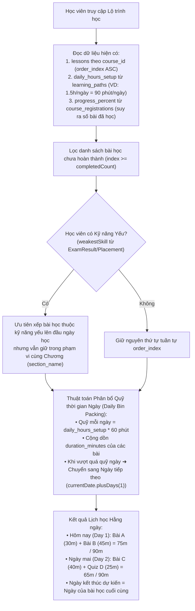

# BÁO CÁO KIỂM TOÁN CẤU TRÚC KHÓA HỌC & BÀI HỌC TRONG HỆ THỐNG JEPS
## Audit of Existing Course Structure, Hierarchy, and Daily Learning Path Feasibility

> **Ngày thực hiện:** 11/11/2026  
> **Phương pháp kiểm toán:** Read-only Source Code Tracing & Live Supabase PostgreSQL Schema Inspection  
> **Tài liệu tham chiếu:** `docs/Course_Structure_Audit.md`  
> **Cơ sở dữ liệu kiểm toán:** Supabase PostgreSQL (`aws-0-ap-south-1.pooler.supabase.com:6543/postgres`)

---

## MỤC LỤC
1. [A. Actual Course Hierarchy (Phân cấp Khóa học Thực tế)](#a-actual-course-hierarchy)
2. [B. Entity Relationship Mapping (Sơ đồ Thực thể Mermaid ERD)](#b-entity-relationship-mapping)
3. [C. Manager Content Management Flow (Quy trình Quản lý Nội dung)](#c-manager-content-management-flow)
4. [D. Learner Content Access Flow (Quy trình Học viên Tiếp cận Nội dung)](#d-learner-content-access-flow)
5. [E. Existing Course Data Example (Dữ liệu Thực tế từ Cơ sở Dữ liệu)](#e-existing-course-data-example)
6. [F. Daily Learning Path Feasibility (Tính khả thi của Lộ trình Học Hằng ngày)](#f-daily-learning-path-feasibility)
7. [G. Gaps and Architectural Risks (Hạn chế & Rủi ro Kiến trúc)](#g-gaps-and-architectural-risks)
8. [H. Final Conclusion (Kết luận & Trả lời Trực diện 8 Câu hỏi Cốt lõi)](#h-final-conclusion)

---

## A. ACTUAL COURSE HIERARCHY

Qua kiểm tra đối chiếu trực tiếp mã nguồn Java Spring Boot (`com.jlpp.modules.course`, `com.jlpp.modules.manager`, `com.jlpp.modules.quiz`, `com.jlpp.modules.flashcard`) và truy vấn schema PostgreSQL thực tế, **cấu trúc phân cấp nội dung thực tế trong JEPS là**:

$$\mathbf{Course} \longrightarrow \mathbf{Lesson} \;\; [\text{gắn thuộc tính Chapter } (\texttt{section\_name}) \;\&\; \text{Skill } (\texttt{skill\_type})]$$
$$\rotatebox[origin=c]{180}{$\mathbf{L}$}\longrightarrow \{\mathbf{StudyMaterial},\; \mathbf{Flashcard},\; \mathbf{Exercise/Quiz},\; \mathbf{LessonDetail}\}$$

### Cây phân cấp thực tế (Physical & Logical Hierarchy):

```text
Course (Bảng 'courses')
  │
  ├── [Thuộc tính logic: level (N5..N1), covered_skills (chuỗi), duration_hours]
  │
  └── Lesson (Bảng 'lessons' - Khóa ngoại course_id -> courses.course_id)
        │
        ├── [Thuộc tính Chapter logic]: section_name (VARCHAR 150 - VD: "Chương 1: Chào hỏi & Giới thiệu bản thân")
        ├── [Thuộc tính Skill logic]: skill_type (VARCHAR 50 - Enum: VOCABULARY, GRAMMAR, KANJI, LISTENING, READING)
        ├── [Thuộc tính Định dạng]: lesson_type (VARCHAR 30 - VIDEO, READING, PRACTICE, QUIZ, FLASHCARD)
        ├── [Thuộc tính Thời lượng]: duration_minutes (INTEGER - số phút học dự kiến)
        ├── [Thuộc tính Thứ tự]: order_index / lesson_order (INTEGER - số thứ tự 1..n trong khóa học)
        │
        ├── StudyMaterial (Bảng 'study_materials' - Khóa ngoại lesson_id -> lessons.lesson_id) [Tài liệu đính kèm: PDF, Audio, Docs]
        │
        ├── Flashcard (Bảng 'flashcards' - Khóa ngoại lesson_id -> lessons.lesson_id) [Thẻ từ vựng SRS theo bài]
        │
        ├── Exercise / Quiz (Bảng 'exercises' - Khóa ngoại lesson_id -> lessons.lesson_id) [Bài kiểm tra trắc nghiệm củng cố]
        │     └── ExerciseQuestion (Bảng 'exercise_questions' -> questions.id)
        │
        └── LessonDetail (Bảng 'lesson_details' - Khóa chính & Khóa ngoại lesson_id -> lessons.lesson_id) [1-1 Payload: audio, jsonb]
```

### Khẳng định kiến trúc then chốt:
1. **Không có bảng `chapters` trong cơ sở dữ liệu.** Chương (Chapter) là một **nhóm phân loại logic** được lưu trực tiếp dưới dạng chuỗi văn bản ở cột `lessons.section_name`.
2. **Không có bảng `skills` trong cơ sở dữ liệu.** Kỹ năng (Skill) được định nghĩa bằng Java Enum `SkillTypeEnum` gồm 5 giá trị cố định (`VOCABULARY`, `GRAMMAR`, `KANJI`, `LISTENING`, `READING`) và được lưu dưới dạng chuỗi văn bản tại cột `lessons.skill_type`.
3. **Mỗi bài học (`Lesson`) chỉ thuộc về DUY NHẤT 1 Khóa học, 1 Chương (`section_name`) và 1 Kỹ năng (`skill_type`).**
4. **Một Chương (`section_name`) có thể chứa nhiều Bài học thuộc CÙNG một kỹ năng hoặc KHÁC kỹ năng.**
5. **Flashcard, Quiz (Exercise), và Study Material là các thực thể con phụ thuộc vào Lesson thông qua khóa ngoại `lesson_id`.**
6. **Milestone Exam (`exams`) liên kết ở cấp Khóa học (`exams.course_id -> courses.course_id`), KHÔNG gắn trực tiếp vào từng bài học hay từng chương.**

---

## B. ENTITY RELATIONSHIP MAPPING

Dưới đây là sơ đồ Mermaid ERD mô tả chính xác 100% các bảng và mối quan hệ khóa ngoại (Foreign Keys) đang hoạt động trong cơ sở dữ liệu PostgreSQL của JEPS:

```mermaid
erDiagram
    courses ||--o{ lessons : "contains (1:N via course_id)"
    courses ||--o{ course_registrations : "enrolled_in (1:N via course_id)"
    courses ||--o{ learning_paths : "guided_by (1:N via course_id)"
    courses ||--o{ exams : "evaluates (1:N via course_id [MILESTONE])"

    users ||--o{ course_registrations : "registers (1:N via user_id)"
    users ||--o{ learning_paths : "owns (1:N via user_id)"
    users ||--o{ exercise_results : "submits (1:N via user_id)"
    users ||--o{ exam_results : "takes (1:N via user_id)"

    lessons ||--o{ study_materials : "attaches (1:N via lesson_id)"
    lessons ||--o{ flashcards : "contains_cards (1:N via lesson_id)"
    lessons ||--o{ exercises : "has_quizzes (1:N via lesson_id)"
    lessons ||--o| lesson_details : "stores_payload (1:1 via lesson_id)"

    exercises ||--o{ exercise_questions : "includes (1:N via exercise_id)"
    questions ||--o{ exercise_questions : "referenced_in (1:N via question_id)"
    questions ||--o{ question_options : "has_options (1:N via question_id)"
    exercises ||--o{ exercise_results : "records_score (1:N via exercise_id)"

    courses {
        bigint course_id PK
        bigint id "Mirrored PK"
        varchar course_title
        varchar title
        varchar level
        varchar code
        varchar status "PUBLISHED, DRAFT"
        double_precision price
        integer duration_hours
        integer lesson_count
        varchar covered_skills
        text objectives
        varchar prerequisites
    }

    lessons {
        bigint lesson_id PK
        bigint id "Mirrored PK"
        bigint course_id FK
        varchar lesson_title
        varchar title
        varchar section_name "Chapter string"
        varchar skill_type "Enum: VOCABULARY, GRAMMAR..."
        varchar lesson_type "VIDEO, READING, PRACTICE, QUIZ..."
        integer order_index "Sequential order 1..n"
        integer lesson_order "Mirrored order"
        integer duration_minutes "Estimated minutes"
        varchar status "PUBLISHED, ACTIVE, DRAFT"
        boolean is_free_preview
        text content
    }

    lesson_details {
        bigint lesson_id PK_FK
        varchar skill_type
        bigint source_entry_id
        text audio_url
        text body
        jsonb payload
    }

    study_materials {
        bigint material_id PK
        bigint lesson_id FK
        varchar material_title
        varchar material_type "PDF, AUDIO, HANDBOOK..."
        text audio_url
        text file_url
        varchar skill_type
    }

    flashcards {
        bigint flashcard_id PK
        bigint lesson_id FK
        varchar vocabulary
        varchar reading
        text meaning
        text example_sentence
        varchar jlpt_level
    }

    exercises {
        bigint exercise_id PK
        bigint lesson_id FK
        varchar exercise_title
        integer total_questions
        integer passing_score
        varchar status
    }

    course_registrations {
        bigint id PK
        bigint user_id FK
        bigint course_id FK
        timestamp registered_at
        varchar status "ACTIVE, COMPLETED"
        integer progress_percent "Aggregate 0..100%"
        double_precision paid_amount
        varchar payment_method
    }

    learning_paths {
        bigint learning_path_id PK
        bigint user_id FK
        bigint course_id FK
        numeric daily_hours_setup "Hours/day"
        varchar target_level
        varchar current_level
        date scheduled_date "Start date"
        varchar path_status "ACTIVE, PAUSED"
    }

    exams {
        bigint exam_id PK
        bigint course_id FK "Nullable (for MILESTONE)"
        varchar exam_title
        varchar exam_type "MILESTONE, JLPT_MOCK, PLACEMENT_TEST"
        varchar jlpt_level
        integer duration_minutes
        integer passing_score
    }
```

---

## C. MANAGER CONTENT MANAGEMENT FLOW

### 1. Quy trình Quản lý Khóa học (Course Management)
* **Controller:** `ManagerCourseController.java` (`/manager/courses`)
* **Service:** `com.jlpp.modules.manager.courses.service.CourseService`
* **Repository:** `CourseRepository.java` (gọi SQL trực tiếp qua `JdbcTemplate`)
* **Thao tác:**
  * Tạo mới / Sửa thông tin khóa học: Tiêu đề (`title`), mã (`code`), cấp độ (`level` N5–N1), giá (`price`), thời lượng dự kiến (`duration_hours`), kỹ năng bao quát (`covered_skills`), điều kiện tiên quyết (`prerequisites`).
  * Trạng thái khóa học: `DRAFT` $\rightarrow$ `PUBLISHED` $\rightarrow$ `ARCHIVED`. Khóa học chỉ hiển thị với học viên khi ở trạng thái `PUBLISHED`.

### 2. Quy trình Quản lý Chương (Chapter Creation & Management)
* **Thực tế mã nguồn (`ManagerLessonController.java` dòng 356–430):**
  * Khi Manager tạo một chương mới tại URL `/manager/lessons/sections`:
    ```java
    @SessionAttributes("draftChapterNames")
    ...
    draftChapterNames.put(courseId, names);
    ```
  * **Chương mới được lưu tạm vào HTTP Session** (`draftChapterNames`), **CHƯA ĐƯỢC GHI VÀO BẢNG RIÊNG NÀO CẢ**.
  * Chương chỉ chính thức được ghi vĩnh viễn vào cơ sở dữ liệu khi Manager tạo bài học đầu tiên và chọn chương đó. Tên chương được ghi vào cột `lessons.section_name`.
  * Khi Manager đổi tên chương (`/manager/lessons/rename-section`):
    ```sql
    UPDATE lessons SET section_name = ?, updated_at = NOW() 
    WHERE course_id = ? AND section_name = ?
    ```
  * Khi Manager xóa chương (`/manager/lessons/delete-section`):
    ```sql
    UPDATE lessons SET section_name = NULL, updated_at = NOW() 
    WHERE course_id = ? AND section_name = ?
    ```
    *(Các bài học không bị xóa, chỉ chuyển về trạng thái `section_name = NULL` tức "Chưa phân chương")*.

### 3. Quy trình Tạo & Gán Kỹ năng cho Bài học (Lesson & Skill Assignment)
* **Controller:** `ManagerLessonController.java` (`/manager/lessons`)
* **Service:** `com.jlpp.modules.manager.lessons.service.LessonService`
* **Repository:** `com.jlpp.modules.manager.lessons.repository.LessonRepository`
* **Mỗi bài học được gán chính xác 1 Kỹ năng duy nhất:**
  * Thuộc tính `skill_type` lưu mã enum của `SkillTypeEnum`: `VOCABULARY`, `GRAMMAR`, `KANJI`, `LISTENING`, `READING`.
  * Không thể gán đa kỹ năng (multi-skill) trong 1 bài học trên tầng dữ liệu.
* **Tổ chức giao diện Manager (`manager-lessons.html`):**
  * Hiển thị lưới phân chia theo từng Chương (`ChapterGroup`). Trong mỗi chương có 3–4 cột nhóm kỹ năng:
    1. Cột 1: `VOCABULARY,KANJI` (Từ vựng & Hán tự)
    2. Cột 2: `GRAMMAR` (Ngữ pháp)
    3. Cột 3: `READING,LISTENING` (Đọc hiểu & Nghe hiểu)
    4. Cột 4: `OTHER` (Các bài chưa phân loại kỹ năng chuẩn)
  * Hoặc Manager có thể chuyển sang chế độ xem Tab 5 Kỹ năng độc lập (`SkillTab`).
* **Sắp xếp thứ tự (`order_index`):**
  * Khi tạo bài học mới, hệ thống tự động sinh số thứ tự tiếp theo qua query:
    ```sql
    SELECT COALESCE(MAX(order_index), 0) + 1 FROM lessons WHERE course_id = ? AND skill_type = ?
    ```
  * Manager có thể di chuyển bài học lên/xuống (`/manager/lessons/{id}/move`) hoặc kéo thả (`/manager/lessons/reorder`). Hàm `applyColumnOrder` cập nhật lại chuỗi số thứ tự liên tục `1..n` không bị ngắt quãng (`order_index = 1, 2, 3...`) trên toàn khóa học.

### 4. Gắn Flashcard và Quiz vào Bài học
* **Flashcard:** Tạo qua `ManagerFlashcardController.java`, lưu vào bảng `flashcards` với `lesson_id = ?`.
* **Quiz / Exercise:** Tạo qua `ManagerQuizController.java`, lưu vào bảng `exercises` với `lesson_id = ?` và liên kết câu hỏi từ bảng `questions` qua `exercise_questions`.

---

## D. LEARNER CONTENT ACCESS FLOW

### 1. Xem Giáo trình Khóa học (Course Curriculum / Lesson List)
* **Điểm truy cập:** `/learning/courses/{courseId}/lessons` hoặc `/learning/lessons`
* **Controller:** `LearnerCourseController.viewLessonList()` (dòng 153–207)
* **Logic tải dữ liệu:**
  1. Kiểm tra đăng ký khóa học của học viên trong bảng `course_registrations`.
  2. Lấy toàn bộ danh sách bài học:
     ```java
     List<Lesson> lessons = lessonRepository.findByCourseIdOrderByOrderIndexAsc(targetCourseId);
     ```
  3. Gom nhóm theo chương để hiển thị Accordion giao diện:
     ```java
     Map<String, List<Lesson>> groupedLessons = lessons.stream()
         .collect(Collectors.groupingBy(
             l -> l.getSectionName() != null ? l.getSectionName() : "Chương 1: Bài học căn bản",
             LinkedHashMap::new,
             Collectors.toList()
         ));
     ```

### 2. Xác định Tiến độ & Bài học Tiếp theo (Next Lesson Determination)
* **Thực tế lưu trữ tiến độ:**
  * Hệ thống **KHÔNG có bảng lưu lịch sử hoàn thành từng bài học** (`user_lesson_progress` không tồn tại).
  * Toàn bộ tiến độ được lưu bằng **một số nguyên tổng hợp duy nhất** `progress_percent` (0 đến 100%) tại bảng `course_registrations`.
* **Logic suy luận bài đã xong (`LearnerCourseController.java` dòng 195):**
  $$\text{completedCount} = \text{round}\left(\frac{\text{lessons.size}() \times \text{progressPercent}}{100.0}\right)$$
  * Bài học có thứ tự index $\le \text{completedCount}$: Coi là **"Đã hoàn thành"** (Icon tích xanh).
  * Bài học có thứ tự index $= \text{completedCount} + 1$: Coi là **"Đang học"** (Icon play xanh dương).
  * Bài học có thứ tự index $> \text{completedCount} + 1$: Coi là **"Chưa học"** (Icon tròn xám).
* **Nút "Tiếp tục học ngay" (Next Lesson):**
  ```html
  <a th:href="@{/learning/lessons/{id}(id=${lessons[completedCount < totalCount ? completedCount : totalCount - 1].id})}">
  ```
  Hệ thống lấy thẳng bài học ở vị trí `completedCount` trong mảng đã sắp xếp theo `order_index`.

### 3. Học bài & Đánh dấu Hoàn thành (Complete Lesson)
* **Giao diện học:** `/learning/lessons/{lessonId}` (`LearnerCourseController.studyLesson()`)
  * Tự động tải nội dung bài học, tài liệu đính kèm từ `study_materials`, bộ thẻ từ vựng từ `flashcards`, và bài tập trắc nghiệm từ `exercises`.
  * Nút "Bài trước" (`prevLesson`) và "Bài kế tiếp" (`nextLesson`) được lấy dựa trên vị trí liền kề trong danh sách sắp xếp theo `orderIndex`.
* **Khi bấm "Đánh dấu hoàn thành" (`POST /learning/lessons/{lessonId}/complete`):**
  ```java
  int newCompletedCount = Math.max(currentCompletedCount, currentIdx + 1);
  int newPercent = Math.min(100, (int) Math.round((newCompletedCount * 100.0) / courseLessons.size()));
  registration.setProgressPercent(newPercent);
  if (newPercent >= 100) registration.setStatus("COMPLETED");
  courseRegistrationRepository.save(registration);
  ```
  Hệ thống cập nhật lại tỷ lệ phần trăm `progress_percent` và tự động chuyển hướng người học sang bài học kế tiếp `next.getId()`.

### 4. Kiểm tra Quy tắc Khóa/Mở bài học (Locking & Prerequisites)
* **Khóa/Mở bài học:** Mặc dù giao diện hiển thị trạng thái "Chưa học" hay "Đã hoàn thành", nhưng trong code **hoàn toàn KHÔNG có logic chặn (Hard Lock)**. Học viên có thể click vào bất kỳ bài học nào để học mà không bị 403 Forbidden.
* **Ràng buộc Tiên quyết (Prerequisites):** Cột `courses.prerequisites` chỉ là văn bản mô tả thuần túy hiển thị trên UI. Không có mã nguồn nào kiểm tra điều kiện tiên quyết trước khi mở bài học.
* **Ràng buộc Milestone Exam:** Mặc dù có bài thi cột mốc `MILESTONE` gắn với khóa học trong bảng `exams`, nhưng việc làm hay chưa làm bài kiểm tra cột mốc **không ảnh hưởng gì đến quyền truy cập bài học tiếp theo**.

---

## E. EXISTING COURSE DATA EXAMPLE

*(Trích xuất trực tiếp từ cơ sở dữ liệu Supabase PostgreSQL thực tế vào lúc 22:16 ngày 11/11/2026)*

### 1. Khóa học N3 (`courses` ID = 3): Khóa học Chinh Phục JLPT N3 Toàn Diện
* **Course ID:** `3`
* **Tiêu đề:** Khóa học Chinh Phục JLPT N3 Toàn Diện
* **Cấp độ:** `N3` | **Giá:** `999,000 VND` | **Thời lượng:** `80 giờ` | **Số bài:** `12 bài`
* **Kỹ năng bao quát:** `Chữ Hán, Từ vựng, Ngữ pháp, Đọc hiểu, Nghe hiểu, Luyện đề`
* **Trạng thái:** `PUBLISHED`

#### Chi tiết 12 Bài học thực tế:

| STT (`order_index`) | Lesson ID | Tên Bài Học (`title`) | Chương (`section_name`) | Kỹ năng (`skill_type`) | Dạng (`lesson_type`) | Thời lượng (`duration_minutes`) | Flashcard / Quiz đính kèm |
| :---: | :---: | :--- | :--- | :---: | :---: | :---: | :---: |
| **1** | `94` | Bài 1: Giới thiệu tổng quan lộ trình JLPT N3 và phương pháp học hiệu quả | Chương 1: Kiến thức nền tảng & Định hướng học tập | `VIDEO` | `VIDEO` | 25 phút | 0 FC / 0 Quiz |
| **2** | `95` | Bài 2: Tổng hợp hệ thống quy tắc ngữ âm và từ vựng mở đầu N3 | Chương 1: Kiến thức nền tảng & Định hướng học tập | `READING` | `READING` | 30 phút | 0 FC / 0 Quiz |
| **3** | `96` | Bài 3: Từ vựng theo ngữ cảnh đời sống thường nhật và giao tiếp N3 | Chương 2: Chữ Hán & Từ vựng chuyên đề | `VIDEO` | `VIDEO` | 35 phút | 0 FC / 0 Quiz |
| **4** | `97` | Bài 4: Hệ thống Chữ Hán cốt lõi và kỹ thuật nhớ nhanh qua bộ thủ | Chương 2: Chữ Hán & Từ vựng chuyên đề | `PRACTICE` | `PRACTICE` | 40 phút | 0 FC / 0 Quiz |
| **5** | `98` | Bài 5: Bài tập củng cố Từ vựng - Chữ Hán có phản hồi tương tác | Chương 2: Chữ Hán & Từ vựng chuyên đề | `QUIZ` | `QUIZ` | 25 phút | 0 FC / 0 Quiz |
| **6** | `99` | Bài 6: Ngữ pháp phần 1: Các mẫu câu và cách liên kết tư duy logic N3 | Chương 3: Cú pháp & Ngữ pháp trọng tâm | `VIDEO` | `VIDEO` | 45 phút | 0 FC / 0 Quiz |
| **7** | `100` | Bài 7: Ngữ pháp phần 2: Phân biệt các cấu trúc tương đồng dễ gây nhầm lẫn | Chương 3: Cú pháp & Ngữ pháp trọng tâm | `READING` | `READING` | 35 phút | 0 FC / 0 Quiz |
| **8** | `101` | Bài 8: Thực hành đặt câu và luyện tập ngữ pháp theo ngữ cảnh thực tế | Chương 3: Cú pháp & Ngữ pháp trọng tâm | `PRACTICE` | `PRACTICE` | 30 phút | 0 FC / 0 Quiz |
| **9** | `102` | Bài 9: Kỹ thuật phân tích bài Đọc hiểu và phương pháp tìm từ khóa then chốt | Chương 4: Kỹ năng Đọc hiểu & Nghe hiểu thực chiến | `VIDEO` | `VIDEO` | 40 phút | 0 FC / 0 Quiz |
| **10** | `103` | Bài 10: Rèn luyện kỹ năng Nghe hiểu phản xạ theo tốc độ tự nhiên | Chương 4: Kỹ năng Đọc hiểu & Nghe hiểu thực chiến | `PRACTICE` | `PRACTICE` | 35 phút | 0 FC / 0 Quiz |
| **11** | `104` | Bài 11: Tổng kết kiến thức toàn diện & Chiến lược phân bổ thời gian phòng thi | Chương 5: Tổng ôn & Đề thi thử chuẩn format JLPT | `VIDEO` | `VIDEO` | 30 phút | 0 FC / 0 Quiz |
| **12** | `105` | Bài 12: Đề kiểm tra đánh giá năng lực cuối khóa chuẩn format JLPT N3 | Chương 5: Tổng ôn & Đề thi thử chuẩn format JLPT | `QUIZ` | `QUIZ` | 60 phút | 0 FC / 0 Quiz |

---

### 2. Ví dụ Khóa học có Đầy đủ Nội dung Con: Khóa học N5 (`courses` ID = 1)
Trong khóa học N5, dữ liệu thực tế cho thấy cấu trúc liên kết Flashcard và Exercise hoạt động hoàn hảo:
* **Lesson #1459** (`Flashcard: Từ vựng Chương 1`): Chứa **75 thẻ Flashcard** trong bảng `flashcards` (`lesson_id = 1459`).
* **Lesson #1460** (`Luyện tập: Từ vựng Chương 1`): Chứa **1 bài Exercise** (`lesson_id = 1460`) với các câu hỏi trắc nghiệm liên kết qua `exercise_questions`.
* **Lesson #1471** (`Flashcard: Hán tự Chương 1`): Chứa **10 thẻ Flashcard** Hán tự.
* **Lesson #1472** (`Luyện tập: Hán tự Chương 1`): Chứa **1 bài Exercise** luyện viết Hán tự.

---

## F. DAILY LEARNING PATH FEASIBILITY

### Bảng Đánh giá Mức độ Hỗ trợ của Dữ liệu Hiện tại:

| Thành phần thông tin cần cho Daily Learning Path | Mức độ hỗ trợ | Bằng chứng từ Mã nguồn / Cơ sở Dữ liệu | Giới hạn & Điểm cần lưu ý |
| :--- | :---: | :--- | :--- |
| **1. Lấy toàn bộ bài học của khóa học đã đăng ký** | **Supported** | `lessonRepository.findByCourseIdOrderByOrderIndexAsc(courseId)` | Đã được sắp xếp sẵn theo `order_index`. |
| **2. Thông tin Chương của từng bài học** | **Supported** | Cột `lessons.section_name` (String) | Là chuỗi văn bản, không có ID chương riêng. Phân nhóm bằng chuỗi. |
| **3. Phân loại Kỹ năng (Skill category)** | **Supported** | Cột `lessons.skill_type` (Enum `SkillTypeEnum`) | Chuẩn hóa 5 kỹ năng: `VOCABULARY`, `GRAMMAR`, `KANJI`, `LISTENING`, `READING`. |
| **4. Thứ tự hiển thị bài học** | **Supported** | Cột `lessons.order_index` (và `lesson_order`) | Là số nguyên tăng dần liên tục trong khóa học. |
| **5. Thời lượng ước tính của bài học** | **Supported** | Cột `lessons.duration_minutes` | Có sẵn thời lượng tính bằng phút cho từng bài (20m, 30m, 40m, 60m). |
| **6. Trạng thái hoàn thành bài học của học viên** | **Partially Supported** | Cột `course_registrations.progress_percent` | **Không có bảng log chi tiết từng bài.** Trạng thái hoàn thành được **suy luận tuần tự**: Các bài có chỉ số $< \text{round}(N \times \text{progress}\%)$ được coi là hoàn thành. |
| **7. Flashcard hoặc Quiz gắn kèm bài học** | **Supported** | `flashcardRepository.findByLessonId(id)`, `exerciseRepository.findByLessonId(id)` | Khóa ngoại `lesson_id` tồn tại ở cả 2 bảng `flashcards` và `exercises`. |
| **8. Bài thi cột mốc (Milestone Exam)** | **Partially Supported** | Bảng `exams` có `course_id` và `exam_type = 'MILESTONE'` | Gắn ở cấp độ Khóa học (`course_id`), KHÔNG gắn ở cấp độ Chương hay Bài học cụ thể. |

---

### Cơ chế Hoạt động của Thuật toán Lộ trình Học Hằng ngày (Daily Learning Path Algorithm)
*(Chỉ sử dụng dữ liệu và bảng hiện có, KHÔNG tạo thêm bảng hay cột mới)*



#### Các trường hợp nghiệp vụ được hỗ trợ ngay lập tức:
1. **Phân bổ bài học theo ngày (Daily Allocation):**
   * Sử dụng cột `duration_minutes` của bài học và ngân sách `daily_hours_setup * 60` phút mỗi ngày từ bảng `learning_paths`.
   * Cộng dồn bài học vào từng ngày cho đến khi đạt ngưỡng thời gian, bài tiếp theo tự động đẩy sang ngày hôm sau.
2. **Ưu tiên kỹ năng còn yếu (Weak-skill Prioritization):**
   * Từ kết quả bài thi thử hoặc bài test đầu vào (`ExamResultResponse.weakestSkill`), thuật toán có thể ưu tiên chọn các bài học có `skill_type` trùng với kỹ năng yếu học trước trong cùng một chương (`section_name`), mà không làm đảo lộn cấu trúc tổng thể của khóa học.
3. **Mô phỏng và Tính toán lại linh hoạt (Dynamic Recalculation):**
   * Hàm `rescheduleItems()` trong [LearningPathServiceImpl.java](file:///c:/Users/hoang/Downloads/JEPS/src/main/java/com/jlpp/modules/learningpath/service/impl/LearningPathServiceImpl.java#L316-L373) đã chứng minh khả năng tính toán lại toàn bộ lịch học trong vài mili-giây trên RAM khi học viên thay đổi số giờ học mỗi tuần mà không cần ghi đè DB.

---

## G. GAPS AND ARCHITECTURAL RISKS

Qua kiểm toán chi tiết, chúng tôi ghi nhận 6 hạn chế và rủi ro kiến trúc cần lưu ý:

1. **Tiến độ học tập lưu dạng Tỷ lệ phần trăm gộp (`progress_percent`), không có bảng log chi tiết từng bài:**
   * *Mô tả:* Cơ sở dữ liệu không có bảng `lesson_completions (user_id, lesson_id, completed_at)`.
   * *Hệ quả:* Hệ thống bắt buộc phải giả định học viên học tuần tự từ bài 1 đến bài $N$. Nếu học viên nhảy cóc sang học bài 8 trước rồi quay lại học bài 2, tỷ lệ phần trăm sẽ bị tính nhảy vọt và coi như các bài từ 1 đến 7 đã hoàn thành.
   * *Giải pháp đề xuất cho Daily Path:* Duy trì thuật toán phân bổ tuần tự dựa trên `order_index` để tránh xung đột với cơ chế tính tiến độ hiện tại.

2. **Dữ liệu cột kép song song (Dual Column Redundancy) trong bảng `lessons`:**
   * *Mô tả:* Do các lần cập nhật schema và migration trước đây, bảng `lessons` đang tồn tại song song:
     * `lesson_title` và `title`
     * `skill_type` và `lesson_type`
     * `order_index` và `lesson_order`
     * `lesson_id` và `id`
   * *Rủi ro:* Trong `managerLessonRepository`, code buộc phải update cả 2 cột để đồng bộ. Khi truy vấn trong service mới, cần sử dụng đúng tên cột chuẩn (`skill_type`, `order_index`, `duration_minutes`, `section_name`).

3. **Chương (`Chapter`) là chuỗi tự do, không có khóa ngoại hay ID riêng:**
   * *Mô tả:* Cột `section_name` là chuỗi tự do (VARCHAR 150). Nếu Manager gõ sai chính tả một ký tự (ví dụ: `"Chương 1"` và `"Chương 1:"`), hệ thống sẽ hiểu là 2 chương hoàn toàn khác nhau.
   * *Hạn chế:* Không thể gán mô tả chương, tài liệu chương hay ảnh bìa chương một cách độc lập.

4. **Chưa có ràng buộc tiên quyết cứng (No Hard Prerequisite Engine):**
   * *Mô tả:* Không có quan hệ khóa ngoại giữa các bài học thể hiện điều kiện "Học xong bài A mới được mở bài B".
   * *Đánh giá rủi ro:* Rủi ro thấp đối với việc lập lịch, vì Daily Learning Path chỉ đóng vai trò gợi ý lộ trình thông minh cho người học chứ không cần cơ chế khóa cứng khắt khe.

5. **Milestone Exam chưa liên kết ở cấp độ Chương:**
   * *Mô tả:* Bảng `exams` chỉ có `course_id`, không có `section_name`. Do đó không thể biết bài thi cột mốc này tương ứng với kết thúc của Chương nào nếu không dựa vào tiêu đề văn bản (`exam_title`).

6. **Một số bài học chưa được điền `duration_minutes`:**
   * *Mô tả:* Trong dữ liệu kiểm toán, một số bài học tạo thử nghiệm có `duration_minutes = null` hoặc `duration_minutes = 1`.
   * *Giải pháp an toàn:* Trong code dịch vụ, luôn sử dụng giá trị fallback: `duration = (lesson.durationMinutes != null && lesson.durationMinutes > 0) ? lesson.durationMinutes : 30`.

---

## H. FINAL CONCLUSION
### (Trả lời Trực diện 8 Câu hỏi Cốt lõi của Nhiệm vụ)

#### 1. Cấu trúc phân cấp Khóa học chính xác hiện tại trong JEPS là gì?
> **Khóa học (`Course`) $\longrightarrow$ Bài học (`Lesson`) $\longrightarrow$ {Tài liệu (`StudyMaterial`), Thẻ từ vựng (`Flashcard`), Bài tập (`Exercise/Quiz`), Chi tiết (`LessonDetail`)}**.  
> Cả **Chương (`Chapter`)** và **Kỹ năng (`Skill`)** đều không phải là các cấp cha mẹ độc lập trong cơ sở dữ liệu, mà là **các thuộc tính phân loại trực tiếp của từng Bài học** (`section_name` và `skill_type`).

#### 2. Chapter có phải là một thực thể cơ sở dữ liệu thực sự hay chỉ là một nhóm logic?
> **Chapter 100% là một NHÓM LOGIC (Logical Grouping)**, hoàn toàn không có bảng `chapters` trong cơ sở dữ liệu. Nó được lưu trữ thuần túy dưới dạng chuỗi văn bản tại cột `lessons.section_name`.

#### 3. Bài học được liên kết với Kỹ năng như thế nào?
> Mỗi bài học được liên kết với **duy nhất một Kỹ năng** thông qua cột chuỗi `lessons.skill_type` (và `lessons.lesson_type`), tương ứng với 5 giá trị cố định trong Java Enum `SkillTypeEnum`: `VOCABULARY`, `GRAMMAR`, `KANJI`, `LISTENING`, `READING`.

#### 4. Thời lượng bài học có sẵn trong dữ liệu không?
> **CÓ.** Bảng `lessons` có sẵn cột `duration_minutes` (kiểu dữ liệu `integer`), ghi lại số phút học dự kiến của bài học (ví dụ: 15 phút, 20 phút, 30 phút, 45 phút, 60 phút).

#### 5. Hệ thống có thể xác định Bài học tiếp theo một cách đáng tin cậy không?
> **CÓ.** Bằng cách kết hợp danh sách bài học sắp xếp theo `order_index ASC` và tỷ lệ `course_registrations.progress_percent`, hệ thống xác định chính xác bài học tiếp theo bằng công thức:  
> `nextLessonIndex = round((totalLessons * progressPercent) / 100.0)`.

#### 6. Các bài học hiện có có thể được tự động phân bổ vào các ngày học không?
> **CÓ, HOÀN TOÀN KHẢ THI.** Thuật toán phân bổ theo ngày chỉ cần đọc `duration_minutes` của từng bài học và ngân sách thời gian hằng ngày `daily_hours_setup * 60` từ bảng `learning_paths` để cộng dồn bài học vào từng ngày học liên tiếp (`currentDate.plusDays(1)` khi vượt quá ngân sách).

#### 7. Có thể ưu tiên các bài học kỹ năng yếu mà không phá vỡ thứ tự chương không?
> **CÓ.** Thuật toán có thể gom các bài học trong cùng một Chương (`section_name`), sau đó sắp xếp ưu tiên các bài có `skill_type` trùng với kỹ năng yếu (`weakestSkill`) lên học trước trong phạm vi chương đó, sau đó mới đến các bài học kỹ năng khác, vừa giúp cải thiện điểm yếu vừa giữ vững tính liền mạch của chương.

#### 8. Có thể triển khai Lộ trình Học Hằng ngày Cá nhân hóa (Personalized Daily Learning Path) mà KHÔNG cần thay đổi schema cơ sở dữ liệu không?
> **HOÀN TOÀN CÓ THỂ (100% FEASIBLE).**  
> Toàn bộ các trường dữ liệu cần thiết:
> * Khóa học (`courses.id`, `courses.title`)
> * Thứ tự bài học (`lessons.order_index`)
> * Tên chương (`lessons.section_name`)
> * Kỹ năng (`lessons.skill_type`)
> * Thời lượng (`lessons.duration_minutes`)
> * Tiến độ học viên (`course_registrations.progress_percent`)
> * Cường độ học (`learning_paths.daily_hours_setup`, `learning_paths.scheduled_date`)
> * Thẻ nhớ & Bài tập (`flashcards.lesson_id`, `exercises.lesson_id`)  
> **Đều đã có sẵn đầy đủ trong cơ sở dữ liệu PostgreSQL hiện tại.** Thuật toán Daily Learning Path hoàn toàn có thể được xây dựng ở tầng Service trong Spring Boot mà không cần thêm bất kỳ bảng hoặc cột nào mới.

