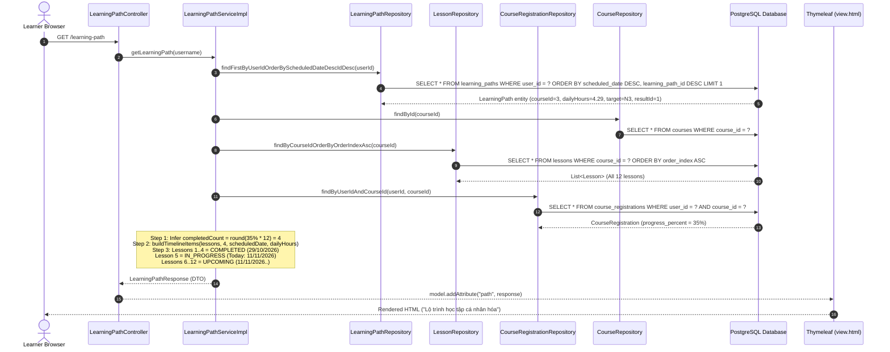
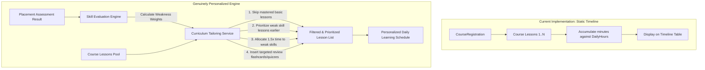

# Comprehensive Technical Audit: Current JEPS Learning Path — Real Personalization or Timeline Display?

> **Audit Type:** Read-Only Software Architecture, Business Logic, and Database Audit  
> **Target Module:** `com.jlpp.modules.learningpath`  
> **System:** JEPS (Japanese Exam Preparation System) — Spring Boot 3.x, Thymeleaf, PostgreSQL  
> **Auditor Role:** Senior Java Spring Boot Architect, Business Analyst, and Software Logic Auditor  
> **Date:** November 2026  
> **Repository Baseline:** Branch `develop`  

---

## 1. Executive Summary & Core Verdict

### 1.1 The Core Verdict

Based on an exhaustive, read-only audit of the Java source code (`com.jlpp.modules.learningpath`), database tables (`learning_paths`, `course_registrations`, `lessons`, `courses`, `exam_results`), SQL queries, and Thymeleaf UI templates, the current JEPS Learning Path is classified as:

$$\mathbf{Category\ B:\ Duration\text{-}Based\ Lesson\ Scheduling\ Engine\ +\ Category\ A:\ Timeline\ Visualization}$$

It is **NOT**:
- $\mathbf{Category\ C:\ Assessment\text{-}Based\ Personalized\ Scheduling}$
- $\mathbf{Category\ D:\ Adaptive\ Skill\text{-}Aware\ Learning\ Engine}$

### 1.2 Summary of Findings

| Evaluation Criterion | Actual Implementation Status | Detailed Technical Reality |
| :--- | :---: | :--- |
| **Rule 1: Retrieve Existing Course & Lessons** | **FULLY IMPLEMENTED** | Retrieves Course via `courseRepository.findById()` and all lessons via `lessonRepository.findByCourseIdOrderByOrderIndexAsc()`. Respects `order_index`. |
| **Rule 2: Placement Assessment Integration** | **ORNAMENTAL / DISPLAY ONLY** | Entity stores `result_id`, `current_level`, and `target_level`. However, `LearningPathServiceImpl` **never** inspects `exam_results`, `exam_question_answers`, skill breakdown, or weakest/strongest skills to alter curriculum. |
| **Rule 3: Chapter & Lesson Eligibility** | **STATIC (100% Passthrough)** | Includes 100% of lessons in the Course in strict manager-configured order. No lesson filtering, no prerequisite checking, no skill-based omissions. |
| **Rule 4: Weak-Skill Prioritization** | **NOT IMPLEMENTED** | `skill_type` is completely ignored during scheduling. Lessons are never reordered, weak skills are not scheduled earlier, and no extra duration is added to weak skills. |
| **Rule 5: Strong-Skill Review & Reduced Repetition** | **NOT IMPLEMENTED** | No skipping or condensing of strong skills. Strong and weak skills receive identical treatment based solely on the author's static `duration_minutes`. |
| **Timeline Scheduling Logic** | **IMPLEMENTED (Duration-based)** | Calendar dates are generated dynamically by accumulating `lesson.durationMinutes` against a daily budget: `dailyMinutesLimit = dailyHoursSetup * 60`. Incomplete lessons roll over starting from `LocalDate.now()`. |
| **Learning Path Creation** | **MANUAL / PRE-SEEDED ONLY** | No production service or controller creates a `LearningPath` upon user registration or Placement Test completion. The entity exists only if manually seeded in DB. |

---

## 2. Current Learning Path Architecture

The complete call chain from HTTP Request down to the PostgreSQL Database and Thymeleaf Template is illustrated below:



### 2.1 Codebase File Locations

- **Controller:** [`LearningPathController.java`](file:///c:/Users/hoang/Downloads/JEPS/src/main/java/com/jlpp/modules/learningpath/controller/LearningPathController.java#L33-L160)
  - Maps `GET /learning-path`, `GET /learning-path/recalibrate`, `POST /learning-path/recalibrate`, `POST /learning-path/recalibrate/apply`.
- **Service Interface:** [`LearningPathService.java`](file:///c:/Users/hoang/Downloads/JEPS/src/main/java/com/jlpp/modules/learningpath/service/LearningPathService.java)
- **Service Implementation:** [`LearningPathServiceImpl.java`](file:///c:/Users/hoang/Downloads/JEPS/src/main/java/com/jlpp/modules/learningpath/service/impl/LearningPathServiceImpl.java#L48-L434)
- **Domain Entity:** [`LearningPath.java`](file:///c:/Users/hoang/Downloads/JEPS/src/main/java/com/jlpp/modules/learningpath/entity/LearningPath.java#L16-L47)
- **Spring Data Repository:** [`LearningPathRepository.java`](file:///c:/Users/hoang/Downloads/JEPS/src/main/java/com/jlpp/modules/learningpath/repository/LearningPathRepository.java)
- **DTOs:**
  - `LearningPathResponse.java`
  - `LearningPathTimelineItemDto.java`
  - `RecalibratePreviewResponse.java`
  - `RecalibrateRequest.java`
- **UI Templates:**
  - [`templates/pages/learning-path/view.html`](file:///c:/Users/hoang/Downloads/JEPS/src/main/resources/templates/pages/learning-path/view.html)
  - [`templates/pages/learning-path/recalibrate.html`](file:///c:/Users/hoang/Downloads/JEPS/src/main/resources/templates/pages/learning-path/recalibrate.html)

---

## 3. Verification of the Five Business Rules

### 3.1 Rule 1 — Existing Course and Lesson Retrieval
> **Verdict: IMPLEMENTED**

The system directly queries existing Courses and Lessons authored by Course Managers:

1. **Course Retrieval:**  
   In `LearningPathServiceImpl.java` (Line 65):
   ```java
   Course course = courseRepository.findById(lp.getCourseId()).orElse(null);
   ```
2. **Lesson Retrieval:**  
   In `LearningPathServiceImpl.java` (Line 73):
   ```java
   List<Lesson> lessons = lessonRepository.findByCourseIdOrderByOrderIndexAsc(lp.getCourseId());
   ```
3. **Ordering and Grouping:**  
   - Ordered strictly by database column `order_index ASC`.
   - Section names (`section_name`) are retrieved and mapped to `sectionName` in `LearningPathTimelineItemDto` (Lines 290-292):
     ```java
     String sectionName = lesson.getSectionName() != null
             ? lesson.getSectionName()
             : "Chương " + ((i / 5) + 1);
     ```
4. **Attributes Retrieved:**  
   - `duration_minutes` is read and used for time accumulation (Line 249).
   - `lesson_type` is read and mapped to `contentType` (Line 298).
   - **Filter status:** Zero filtering. Every single lesson associated with `course_id` is passed directly into the timeline.

---

### 3.2 Rule 2 — Placement Assessment Integration
> **Verdict: NOT IMPLEMENTED IN SCHEDULING (Ornamental Column Only)**

1. **Database Schema:**  
   The `learning_paths` table contains a foreign key column `result_id` referencing `exam_results(result_id)`.
2. **Entity Definition:**  
   [`LearningPath.java`](file:///c:/Users/hoang/Downloads/JEPS/src/main/java/com/jlpp/modules/learningpath/entity/LearningPath.java#L29-L31):
   ```java
   @Column(name = "result_id")
   private Long resultId;
   ```
3. **Service Logic Audit:**  
   In `LearningPathServiceImpl.java`, the field `resultId` is **never queried or used**:
   - `examResultRepository` is **not injected** into `LearningPathServiceImpl`.
   - There is no lookup of `exam_results`, `exam_question_answers`, or `questions`.
   - The system does **not** evaluate skill scores (Grammar, Vocabulary, Kanji, Reading, Listening).
   - The system does **not** determine the learner's weakest or strongest skill.
   - The `result_id` is purely ornamental metadata that was stored during initial row creation.

---

### 3.3 Rule 3 — Chapter and Lesson Eligibility
> **Verdict: STATIC (100% Passthrough, No Dynamic Selection)**

1. **Lesson Filtering:** None. All lessons matching `course_id` are included in the timeline.
2. **Prerequisites:** JEPS does **not** have a `prerequisites` table, prerequisite column, or DAG (Directed Acyclic Graph) validation.
3. **Differentiation Between Learners:**  
   Two learners enrolled in Course 3 with identical daily hours setup will receive **100% identical lesson lists and schedules**, regardless of their placement test score differences.

---

### 3.4 Rule 4 — Weak-Skill Prioritization
> **Verdict: NOT IMPLEMENTED**

1. **Skill Type Utilization:**  
   While `Lesson.java` contains `skill_type` (mapped to `SkillTypeEnum`), `LearningPathServiceImpl.java` **does not read or reference `skill_type` anywhere** in `buildTimelineItems()` or `rescheduleItems()`.
2. **Ordering:** The sequence is hardcoded to `order_index ASC`.
3. **Time Allocation:** The time allocated for each lesson is strictly `lesson.getDurationMinutes()` (or default 60 minutes). No multiplier or bonus duration is added for weak skills.
4. **Early Scheduling:** Weak-skill lessons are not shifted to earlier dates.

---

### 3.5 Rule 5 — Strong-Skill Review and Reduced Repetition
> **Verdict: NOT IMPLEMENTED**

1. **No Content Skipping:** Learners cannot skip or condense lessons for skills they scored high on in the Placement Test.
2. **No Review Activity Insertion:** There is no automated generation of spaced-repetition review cards or quizzes for strong skills.
3. Every learner is forced through the identical linear curriculum from Lesson 1 to Lesson $N$.

---

## 4. Deep Dive into the Scheduling Algorithm

The scheduling logic is encapsulated in two private methods in `LearningPathServiceImpl.java`:
1. `buildTimelineItems(...)` (Lines 230–314)
2. `rescheduleItems(...)` (Lines 316–373)

### 4.1 How Planned Dates and Weeks Are Computed

```java
// Lines 242-265 of LearningPathServiceImpl.java
int dailyMinutesLimit = dailyHours.multiply(BigDecimal.valueOf(60)).intValue();
if (dailyMinutesLimit <= 0) dailyMinutesLimit = 90;

int accumulatedMinutesToday = 0;

for (int i = 0; i < lessons.size(); i++) {
    Lesson lesson = lessons.get(i);
    int duration = (lesson.getDurationMinutes() != null && lesson.getDurationMinutes() > 0)
            ? lesson.getDurationMinutes()
            : 60;

    // Critical rollover: If we reached the current in-progress lesson and date is in past, snap to today!
    if (i == completedCount && currentDate.isBefore(today)) {
        currentDate = today;
        accumulatedMinutesToday = 0;
    }

    accumulatedMinutesToday += duration;
    if (accumulatedMinutesToday > dailyMinutesLimit) {
        currentDate = currentDate.plusDays(1);
        accumulatedMinutesToday = duration;
    }

    long daysFromStart = ChronoUnit.DAYS.between(courseStart, currentDate);
    int targetWeek = Math.max(1, (int) (daysFromStart / 7) + 1);
    ...
}
```

### 4.2 Exact Explanation of the User's Screenshot

In the screenshot provided by the user:
- **Course:** "Khóa học Chinh Phục JLPT N3 Toàn Diện" (`course_id = 3`, 12 lessons total).
- **Progress:** `35%` $\rightarrow$ `completedLessons = Math.round((35 / 100.0) * 12) = 4`.
- **Start Date:** `29/10/2026`.
- **Current Intensity:** `30 giờ/tuần` $\rightarrow$ `dailyHoursSetup = 4.29` $\rightarrow$ `dailyMinutesLimit = 257 phút/ngày`.
- **Today's System Date:** `11/11/2026`.

#### Execution Step-by-Step:
1. **Lessons 1–4 (Index 0, 1, 2, 3):**
   - Lesson 1 (25m) + Lesson 2 (30m) + Lesson 3 (35m) + Lesson 4 (40m) = $130\text{ minutes} \le 257\text{ min limit}$.
   - All 4 lessons fit on Day 1 (`29/10/2026`, `Tuần 1`).
   - All 4 are $< \text{completedCount } (4)$, so marked **"Đã hoàn thành" (Ôn lại)**.
2. **Transition at Index 4 (Lesson 5):**
   - Line 253 triggers: `if (i == completedCount && currentDate.isBefore(today))`
   - Because `currentDate` (`29/10/2026`) is before `today` (`11/11/2026`), `currentDate` immediately jumps to `11/11/2026`!
3. **Lessons 5–6 (Index 4, 5):**
   - Lesson 5 (25m) + Lesson 6 (45m) = $70\text{ minutes} \le 257\text{ min limit}$.
   - Scheduled on `11/11/2026`, `Tuần 2` (since days between 29/10 and 11/11 is 13 days, $\lfloor 13/7 \rfloor + 1 = 2$).
   - Lesson 5 is at index `completedCount` (4), marked **"Đang học" (Học tiếp)**.
   - Lesson 6 is at index $> \text{completedCount}$, marked **"Chưa học" (Bắt đầu học)**.

This proves mathematically and programmatically why the dates and statuses in the user's screenshot appear exactly as they do.

---

## 5. Placement Assessment Integration: Why `result_id` is Ornamental

```
Placement Assessment (Exam) ──> exam_results (result_id, score, passed, user_id)
                                    │
                                    ├──> exam_question_answers (detailed skill choices)
                                    │
                                    └──> learning_paths (result_id stored as plain column)
                                             │
                                             ▼
                               LearningPathServiceImpl
                                             │
                                             ├──> courseRepository.findById()
                                             ├──> lessonRepository.findByCourseId()
                                             └──> courseRegistrationRepository.findByUserIdAndCourseId()
                                             
                               [NO CALL TO examResultRepository OR SKILL EVALUATION!]
```

- When a learner completes a placement assessment, the system stores `result_id` in `learning_paths`.
- However, when constructing the learning path, `LearningPathServiceImpl` **never joins `exam_results`** or evaluates individual question performance.
- The `target_level` and `current_level` stored in `learning_paths` are rendered as text badges on the card ("Mục tiêu: N3", "ACTIVE"), but **zero business logic in the service adjusts the sequence of lessons based on them**.

---

## 6. Lesson Selection & Chapter Eligibility: Static Sequence

JEPS does not support dynamic curriculum pruning. The table below illustrates how lessons are selected:

| Aspect | Current JEPS Implementation | Genuine Personalized System |
| :--- | :--- | :--- |
| **Lesson Scope** | All lessons in Course (`course_id`) | Selected subset addressing detected learner skill deficits |
| **Sequence Order** | Static `order_index ASC` | Dynamic topological sort or weakness-first ordering |
| **Prerequisites** | None (Lessons are conceptually linear) | Skill dependency graph (e.g., N3 Kanji $\rightarrow$ N3 Reading) |
| **Chapter Handling** | Plain label display (`section_name`) | Modular units that can be tested out of or accelerated |

---

## 7. Weak / Strong Skill Personalization: The Missing Link

In the current schema:
- `lessons.skill_type` exists in PostgreSQL (`VARCHAR(30)` matching `SkillTypeEnum`: `KANJI`, `VOCABULARY`, `GRAMMAR`, `READING`, `LISTENING`).
- `exam_results` records the outcome of exams.
- However, the bridge between these two domains **does not exist in code**:
  1. No weighting algorithm exists ($W_{\text{skill}} = f(\text{PlacementScore})$).
  2. No skill-based duration modifier exists ($\text{Duration}' = \text{Duration} \times (1 + \text{WeaknessScore})$).
  3. No skill reordering exists.

The label "Cá nhân hóa" (Personalized) in the UI refers only to **adjusting timeline dates to the learner's chosen study intensity (hours/week)**, not content-level adaptation.

---

## 8. Learning Path vs. Learner Course Module Responsibilities

| Dimension | Learner Course Module (`/courses`, `/learning/courses`) | Learning Path Module (`/learning-path`) | Assessment |
| :--- | :--- | :--- | :--- |
| **Primary Responsibility** | Content delivery, video viewing, flashcards, taking lesson quizzes, marking progress. | Visualizing study calendar, projecting completion dates, simulating weekly pace. | Distinct UI perspectives on the exact same underlying course. |
| **Data Source** | `courses`, `lessons`, `course_registrations`. | `learning_paths`, `courses`, `lessons`, `course_registrations`. | Both read the exact same 12 lessons. |
| **Progress Source** | Updates `course_registrations.progress_percent`. | Reads `course_registrations.progress_percent`. | No dedicated progress store for Learning Path. |
| **Duplication Level** | **Low to Moderate Duplication**: Learning Path does not re-implement video/quiz delivery; action buttons on the timeline redirect to `/courses`. It is an alternative calendar projection view. |

---

## 9. Two-Learner Controlled Logic Comparison

To conclusively determine whether personalization exists, consider two learners enrolled in the exact same course:

### Simulation Conditions
- **Course:** Khóa học JLPT N3 Toàn Diện (`course_id = 3`, 12 lessons).
- **Weekly Intensity:** 14 hours/week (`dailyHours = 2.0`).
- **Placement Assessment Performance:**
  - **Learner A:** Passed Vocabulary & Kanji (95%), Failed Grammar (30%) and Listening (25%).
  - **Learner B:** Passed Grammar & Reading (90%), Failed Vocabulary (20%) and Kanji (35%).

### Expected vs Actual Output

| Evaluation Field | Learner A Output | Learner B Output | Are Outputs Different? |
| :--- | :--- | :--- | :---: |
| **Lessons Included** | Lessons 1 to 12 | Lessons 1 to 12 | **NO (100% Identical)** |
| **Lesson Sequence** | 1, 2, 3, 4, 5, 6, 7, 8, 9, 10, 11, 12 | 1, 2, 3, 4, 5, 6, 7, 8, 9, 10, 11, 12 | **NO (100% Identical)** |
| **Time Allocated to Lesson 4 (Kanji)** | 40 minutes | 40 minutes | **NO (100% Identical)** |
| **Time Allocated to Lesson 6 (Grammar)** | 45 minutes | 45 minutes | **NO (100% Identical)** |
| **Planned Start / End Dates** | Identical calendar dates | Identical calendar dates | **NO (100% Identical)** |
| **Review Activities** | None added | None added | **NO (100% Identical)** |

**Mathematical Conclusion:**  
$$\text{LearningPlan}(\text{Learner } A) \equiv \text{LearningPlan}(\text{Learner } B)$$  
The system demonstrates **zero content-level personalization** between learners with opposing skill proficiencies.

---

## 10. Feature Implementation Matrix

| No. | Feature Capability | Architectural Classification | Verifiable Implementation Evidence |
| :---: | :--- | :---: | :--- |
| **1** | Course & Lesson Retrieval from Manager catalog | **IMPLEMENTED** | `LearningPathServiceImpl.java` lines 65, 73. |
| **2** | Dynamic Calendar Timeline Projection | **IMPLEMENTED** | `buildTimelineItems()` lines 242-265. |
| **3** | Pace Recalibration & What-If Simulation | **IMPLEMENTED** | `getRecalibratePreview()` and `rescheduleItems()`. |
| **4** | Dynamic In-Progress Date Snapping to Today | **IMPLEMENTED** | `LearningPathServiceImpl.java` lines 253-256. |
| **5** | Placement Assessment Result Storage | **METADATA ONLY** | Entity column `result_id` stored but never read by service logic. |
| **6** | Skill Weakness Identification in Service | **NOT IMPLEMENTED** | No skill score extraction in `LearningPathServiceImpl`. |
| **7** | Weak-Skill Lesson Prioritization / Reordering | **NOT IMPLEMENTED** | Fixed to `lesson.orderIndex ASC`. |
| **8** | Dynamic Lesson Skipping for Strong Skills | **NOT IMPLEMENTED** | 100% of course lessons remain in timeline. |
| **9** | Daily Personalized Activity Generation | **NOT IMPLEMENTED** | Only groups lessons into calendar dates by accumulating minutes. |
| **10**| Automated Learning Path Creation Pipeline | **NOT IMPLEMENTED** | Missing `createLearningPath()` call upon course registration/exam. |

---

## 11. Missing Business Logic & Architectural Gaps

To transform the current Learning Path from a timeline visualization into a genuine personalized learning engine, the following architectural gaps must be addressed:



### Gap 1: Automated LearningPath Generation Hook
Currently, when a user completes a Placement Assessment or registers for a Course, no event listener or service call creates a row in `learning_paths`. This row must currently be manually inserted into the database.

### Gap 2: Skill-Score Bridge
An evaluation component is needed to query `exam_results` and calculate percentage proficiency per skill category (`KANJI`, `VOCABULARY`, `GRAMMAR`, `READING`, `LISTENING`).

### Gap 3: Personalized Sequencing Algorithm
Rather than invoking `findByCourseIdOrderByOrderIndexAsc`, the scheduling service should accept skill weights to sort and filter lessons.

---

## 12. Direct Answers to the 12 Critical Questions

### Q1. Is the current JEPS Learning Path only a timeline display?
**Answer:**  
**No, it is more than a purely static display, but it is not an adaptive learning engine.**  
It is a **Duration-Based Lesson Scheduling Engine**. It performs active calendar scheduling calculations: it consumes `lesson.duration_minutes`, computes daily quotas from `daily_hours_setup`, assigns lessons to specific future dates and target weeks, snaps incomplete lessons to `LocalDate.now()`, and provides interactive "what-if" recalculation simulation. However, on the content and sequencing dimension, it is purely static.

### Q2. Does it contain actual scheduling logic?
**Answer:**  
**Yes.**  
The methods `buildTimelineItems()` and `rescheduleItems()` contain concrete scheduling algorithms based on daily time budgets (`dailyHours * 60`). When lessons exceed the remaining budget for a day, the scheduler rolls over to `currentDate.plusDays(1)`.

### Q3. Does Placement Assessment affect the lesson order?
**Answer:**  
**No.**  
Lesson ordering is strictly determined by `lessonRepository.findByCourseIdOrderByOrderIndexAsc()` (`order_index ASC`). Placement test scores are never queried or used to alter the order of lessons.

### Q4. Are weak skills prioritized?
**Answer:**  
**No.**  
`skill_type` is completely ignored during scheduling. Lessons covering weak skills are not moved forward, nor are they allocated additional study time.

### Q5. Are stronger skills reviewed differently?
**Answer:**  
**No.**  
There is no mechanism to skip lessons, test out of mastered content, or compress durations for stronger skills.

### Q6. Do two learners with different skill strengths receive different learning plans for the same Course?
**Answer:**  
**No.**  
If Learner A (weak in Grammar) and Learner B (weak in Listening) select the same course and the same weekly hours, their learning timelines will be **100% identical in lesson content, sequence, duration, and planned completion dates**.

### Q7. Does the system generate personalized daily Lessons?
**Answer:**  
**No.**  
The system merely groups existing course lessons onto future calendar days until the daily minute cap is met. It does not synthesize custom daily review tasks, flashcard decks, or adaptive question sets.

### Q8. Does Learning Path duplicate the Learner Course module?
**Answer:**  
**No, it complements it as an alternative view.**  
The Learner Course module (`LearnerCourseController`) handles hierarchical chapter navigation and content consumption (video player, quiz taker). The Learning Path module (`LearningPathController`) provides an overarching calendar roadmap and pace adjustment tool. When a learner clicks "Học tiếp" or "Bắt đầu học" on the Learning Path, it directs them to the course learning view.

### Q9. Which features are actually implemented?
**Answer:**  
1. Retrieval of actual courses and lessons authored by Managers (`order_index`, `duration_minutes`, `section_name`).
2. Duration-based daily timeline projection and completion date forecasting.
3. Rollover logic snapping pending lessons to `today` (`LocalDate.now()`).
4. Recalibration simulator allowing learners to change weekly study hours and preview completion date impacts.
5. Inferred lesson completion states based on `course_registrations.progress_percent`.

### Q10. Which features are missing?
**Answer:**  
1. Automated `LearningPath` entity creation trigger upon course registration or placement exam completion.
2. Skill proficiency breakdown analysis from `exam_results`.
3. Weak-skill prioritization and early scheduling.
4. Strong-skill lesson skipping or accelerated pacing.
5. Granular lesson-level completion tracking (relies on coarse mathematical rounding of `progress_percent`).

### Q11. Can the desired personalization be implemented without modifying the existing Course module?
**Answer:**  
**Yes, absolutely.**  
Because `Lesson` already has `skill_type` and `duration_minutes`, and `exam_results` already has answers and scores, personalization can be implemented entirely inside `com.jlpp.modules.learningpath`. The Course module (Manager course creation and catalog) can remain completely untouched.

### Q12. What is the minimum required change to turn the current Learning Path into a genuinely personalized study planning system?
**Answer:**  
The minimal non-breaking change requires three software engineering additions:
1. **Assessment Reader:** A service method in `LearningPathServiceImpl` that inspects `exam_results` for the learner's `result_id` and calculates proficiency percentages for each of the 5 skills.
2. **Skill-Weighted Comparator / Filter:** When fetching `lessons` from `lessonRepository`, apply a sorting comparator:
   - Rank lessons belonging to the learner's weakest skills higher, or adjust their scheduled duration with a multiplier (e.g., $1.25\times$).
   - Optionally mark basic lessons of mastered skills ($>85\%$) as eligible for "Fast Track" review.
3. **Automated Hook:** Add a call to `learningPathService.createOrUpdatePath(...)` inside `CourseRegistrationServiceImpl.registerCourse()` or `ExamServiceImpl.submitExam()`.

