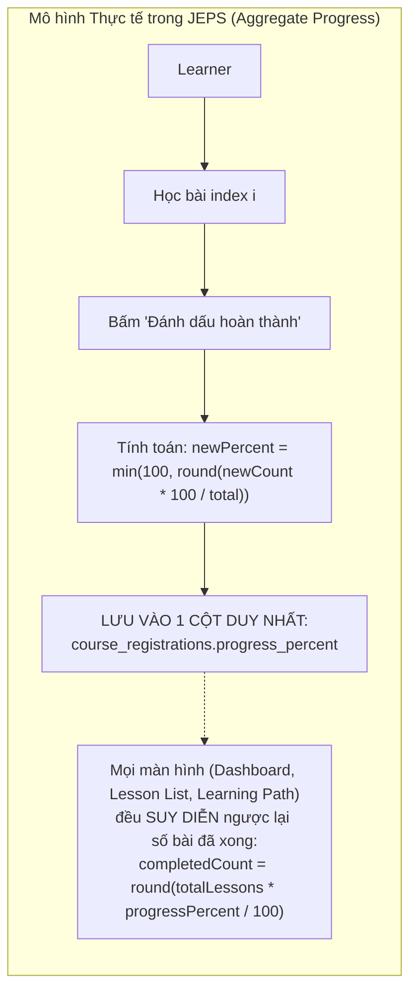

# BÁO CÁO KIỂM TOÁN TIẾN ĐỘ HỌC TẬP CẤP BÀI HỌC (LESSON-LEVEL PROGRESS AUDIT)
## Comprehensive Audit of Lesson Progress Tracking, Continue Learning Logic, and Daily Learning Path Feasibility in JEPS

> **Ngày thực hiện:** 11/11/2026  
> **Chế độ kiểm toán:** Read-Only Investigation (Tuyệt đối không can thiệp code hay cơ sở dữ liệu)  
> **Tài liệu tạo ra:** `docs/Lesson_Progress_Audit.md`  
> **Môi trường đối chiếu:** Mã nguồn Java Spring Boot (`com.jlpp.modules.*`) và Cơ sở dữ liệu Supabase PostgreSQL Live

---

## MỤC LỤC
1. [1. Existing Progress Architecture (Kiến trúc Theo dõi Tiến độ Hiện tại)](#1-existing-progress-architecture)
2. [2. Database Structure (Cấu trúc Bảng & Khóa ngoại Liên quan đến Tiến độ)](#2-database-structure)
3. [3. Completed Lesson Tracking (Cơ chế Theo dõi Bài học Đã Hoàn thành)](#3-completed-lesson-tracking)
4. [4. In-Progress and Last Access Tracking (Theo dõi Bài đang học & Lịch sử Truy cập)](#4-in-progress-and-last-access-tracking)
5. [5. Continue Learning Logic (Giải mã Thuật toán "Tiếp tục học ngay")](#5-continue-learning-logic)
6. [6. Progress Calculation Formulas (Công thức Tính toán Tiến độ Toàn cục)](#6-progress-calculation-formulas)
7. [7. Verified Logic Defects (Các Lỗi Logic Đã Được Xác Minh trong Mã Nguồn)](#7-verified-logic-defects)
8. [8. Unverified Risks (Các Rủi ro Tiềm ẩn Chưa Phát sinh Lỗi)](#8-unverified-risks)
9. [9. Daily Learning Path Feasibility Matrix (Ma trận Khả thi Lộ trình Hằng ngày)](#9-daily-learning-path-feasibility-matrix)
10. [10. Edge Cases Investigation (Kiểm tra 10 Kịch bản Biên Thực tế)](#10-edge-cases-investigation)
11. [11. Final Recommendations (Phương án Triển khai Tối ưu Không Cần Sửa DB)](#11-final-recommendations)
12. [12. Required Final Answers (Trả lời Trực diện 9 Câu hỏi Cốt lõi)](#12-required-final-answers)

---

## 1. EXISTING PROGRESS ARCHITECTURE

Hệ thống JEPS hiện đang áp dụng mô hình **Theo dõi Tiến độ Gộp dạng Tỷ lệ Phần trăm (Aggregate Percentage-Based Progress Model)** thay vì mô hình **Ghi nhận Sự kiện Cấp Bài học (Granular Event-Based Lesson Completion Model)**:



### Bản chất kiến trúc:
1. **Không có bảng `lesson_completions`, `user_lessons` hay `lesson_progress`** để lưu cặp `(user_id, lesson_id, completed_at)`.
2. Toàn bộ lịch sử học tập của học viên trong một khóa học được nén vào **đúng một giá trị số nguyên** `progress_percent` (từ `0` đến `100`) nằm tại bảng `course_registrations`.
3. Mọi tính toán về bài học nào đã xong, bài nào đang học, bài nào chưa học trên giao diện học viên (`lesson-list.html`, `lesson-study.html`, `learning-path/view.html`) đều được **suy diễn gián tiếp (inferred)** từ `progress_percent` theo giả định học viên học tuần tự theo số thứ tự `order_index`.

---

## 2. DATABASE STRUCTURE

Qua kiểm tra trực tiếp metadata của PostgreSQL (`information_schema.columns` và `table_constraints`), dưới đây là danh sách đầy đủ tất cả các bảng và cột thực tế tham gia vào việc lưu trữ và liên kết tiến độ học tập:

| Bảng (Table Name) | Khóa chính (PK) | Khóa ngoại (FK) | Các cột Tiến độ (Progress Fields) | Các cột Thời gian (Timestamps) | Mục đích lưu trữ thực tế |
| :--- | :--- | :--- | :--- | :--- | :--- |
| `course_registrations` | `id` (bigint) | `user_id` $\rightarrow$ `users.user_id`<br>`course_id` $\rightarrow$ `courses.course_id` | `progress_percent` (integer, 0..100)<br>`status` (varchar: 'ACTIVE', 'COMPLETED') | `registered_at` (timestamp)<br>`created_at`, `updated_at` (timestamp) | **Bảng duy nhất lưu tiến độ khóa học.** Lưu trạng thái đăng ký và tỷ lệ % hoàn thành gộp. |
| `learning_paths` | `learning_path_id` (bigint) | `user_id` $\rightarrow$ `users.user_id`<br>`course_id` $\rightarrow$ `courses.course_id`<br>`result_id` $\rightarrow$ `exam_results.result_id` | `daily_hours_setup` (numeric, số giờ/ngày)<br>`path_status` (varchar: 'ACTIVE', 'PAUSED')<br>`target_level`, `current_level` | `scheduled_date` (date: ngày bắt đầu học) | Quản lý kế hoạch học tập cá nhân hóa, số giờ học mỗi ngày, ngày bắt đầu và cấp độ mục tiêu. |
| `lessons` | `lesson_id` (bigint)<br>`id` (bigint) | `course_id` $\rightarrow$ `courses.course_id`<br>`exam_id` (bigint, nullable) | `status` (varchar: 'PUBLISHED', 'ACTIVE')<br>`order_index`, `lesson_order` (int)<br>`duration_minutes` (int) | `created_at`, `updated_at` (timestamp) | Danh mục bài học của khóa học. Cột `status` là trạng thái xuất bản bài giảng, **KHÔNG PHẢI trạng thái học của user**. |
| `exercise_results` | `exercise_result_id` (bigint) | `user_id` $\rightarrow$ `users.user_id`<br>`exercise_id` $\rightarrow$ `exercises.exercise_id` | `score` (int), `percentage` (numeric)<br>`result_status` (varchar: 'PASSED', 'FAILED')<br>`attempt_number` (int) | `submitted_date` (timestamp with time zone) | Lưu kết quả làm bài tập trắc nghiệm củng cố gắn với bài học. |
| `exam_results` | `result_id` (bigint) | `user_id` $\rightarrow$ `users.user_id`<br>`exam_id` $\rightarrow$ `exams.exam_id` | `score` (int), `percentage` (numeric)<br>`passed` (boolean), `answers` (jsonb) | `created_at`, `updated_at` (timestamp) | Lưu kết quả thi thử JLPT, đánh giá đầu vào hoặc thi cột mốc `MILESTONE`. |
| `attempts` | `id` (bigint) | `user_id` $\rightarrow$ `users.user_id`<br>`exam_id`, `exercise_id` | `score`, `passed`, `status` | `started_at`, `submitted_at` (timestamp with time zone) | Bảng cấu trúc đợt thi/làm bài (hiện bảng này đang có 0 bản ghi). |
| `flashcards` | `flashcard_id` (bigint) | `lesson_id` $\rightarrow$ `lessons.lesson_id` | `review_status` (varchar) | Không có timestamp tương tác | Quản lý thẻ từ vựng theo bài học. |

### Xác nhận 6 cấp độ hỗ trợ:
1. **Per-Learner progress:** **CÓ HỖ TRỢ** (thông qua `course_registrations.user_id`).
2. **Per-Course progress:** **CÓ HỖ TRỢ** (thông qua `course_registrations.progress_percent`).
3. **Per-Lesson progress:** **KHÔNG CÓ BẢNG LƯU TRỰC TIẾP** (chỉ suy diễn tuần tự).
4. **Lesson completion timestamps:** **KHÔNG HỖ TRỢ** (không có cột lưu thời điểm hoàn thành từng bài).
5. **Quiz completion tracking:** **CÓ HỖ TRỢ** (thông qua `exercise_results` gắn với `exercise_id` $\rightarrow$ `lesson_id`).
6. **Milestone completion tracking:** **CÓ HỖ TRỢ** (thông qua `exam_results` gắn với bài thi `exam_type = 'MILESTONE'`).

---

## 3. COMPLETED LESSON TRACKING

### Q1. Hệ thống có xác định được chính xác Lesson ID nào đã hoàn thành không?

> **TRẢ LỜI: KHÔNG THỂ XÁC ĐỊNH CHÍNH XÁC NẾU HỌC KHÔNG TUẦN TỰ.**  
> Hệ thống chỉ xác định được danh sách Lesson ID đã hoàn thành **DỰA TRÊN GIẢ ĐỊNH HỌC VIÊN LUÔN HỌC TUẦN TỰ TỪ BÀI ĐẦU ĐẾN BÀI CUỐI**.

#### Bằng chứng mã nguồn:
Trong [LearnerCourseController.java](file:///c:/Users/hoang/Downloads/JEPS/src/main/java/com/jlpp/modules/course/controller/LearnerCourseController.java#L183-L196) (dòng 183–196):
```java
List<Lesson> lessons = lessonRepository.findByCourseIdOrderByOrderIndexAsc(targetCourseId);
CourseRegistration registration = registrationService.getRegistration(learner.getId(), targetCourseId);
int progress = (registration != null && registration.getProgressPercent() != null) ? registration.getProgressPercent() : 0;
int completedCount = (int) Math.round((lessons.size() * progress) / 100.0);
```
Sau đó, trong template [lesson-list.html](file:///c:/Users/hoang/Downloads/JEPS/src/main/resources/templates/pages/learning/lesson-list.html#L126-L132) (dòng 126–132):
```html
<i th:if="${(lesson.orderIndex != null ? lesson.orderIndex : itemStat.index + 1) <= completedCount}" 
   class="bi bi-check-circle-fill text-success fs-5" title="Đã hoàn thành"></i>
```

#### Quy trình ghi nhận khi bấm "Đánh dấu hoàn thành" (`POST /learning/lessons/{lessonId}/complete`):
Trong [LearnerCourseController.java](file:///c:/Users/hoang/Downloads/JEPS/src/main/java/com/jlpp/modules/course/controller/LearnerCourseController.java#L341-L353) (dòng 341–353):
```java
CourseRegistration registration = registrationService.getRegistration(learner.getId(), course.getId());
if (registration != null) {
    int newCompletedCount = Math.max(
            (int) Math.round((courseLessons.size() * (registration.getProgressPercent() != null ? registration.getProgressPercent() : 0)) / 100.0),
            currentIdx + 1
    );
    int newPercent = Math.min(100, (int) Math.round((newCompletedCount * 100.0) / courseLessons.size()));
    registration.setProgressPercent(newPercent);
    if (newPercent >= 100) {
        registration.setStatus("COMPLETED");
    }
    courseRegistrationRepository.save(registration);
}
```

#### Hệ quả kiểm toán:
1. **Không có bản ghi liên kết `user_id` và `lesson_id`:** Cơ sở dữ liệu không lưu vết bài học cụ thể nào đã được bấm hoàn thành.
2. **Không có timestamp hoàn thành bài học:** Không biết học viên hoàn thành bài học vào ngày giờ nào.
3. **Học lại bài học cũ không làm thay đổi thống kê:** Do sử dụng toán tử `Math.max(currentCompletedCount, currentIdx + 1)`, nếu học viên học lại Bài 1 (với `currentIdx = 0`), biểu thức `Math.max(completedCount, 1)` vẫn giữ nguyên `completedCount`, `progress_percent` không bị thay đổi.

---

## 4. IN-PROGRESS AND LAST ACCESS TRACKING

### Q2. Hệ thống có xác định được bài học đang học dở (In-Progress) không?
> **TRẢ LỜI: KHÔNG LƯU TRỮ TRẠNG THÁI THỰC TẾ, CHỈ SUY DIỄN VỊ TRÍ TOÁN HỌC.**

1. **Không có trạng thái bài học theo từng người dùng:** Cột `lessons.status` trong database chỉ mang các giá trị xuất bản khóa học: `'PUBLISHED'`, `'ACTIVE'`, `'DRAFT'`.
2. **Trạng thái "Đang học" trên UI là một trạng thái suy diễn động (Synthesized Dynamic State):**
   * Trong [lesson-list.html](file:///c:/Users/hoang/Downloads/JEPS/src/main/resources/templates/pages/learning/lesson-list.html#L128): Bài học có chỉ số thứ tự đúng bằng `completedCount + 1` được tự động gán icon `bi-play-circle-fill` ("Đang học").
   * Trong [LearningPathServiceImpl.java](file:///c:/Users/hoang/Downloads/JEPS/src/main/java/com/jlpp/modules/learningpath/service/impl/LearningPathServiceImpl.java#L279): Bài học ở vị trí `i == completedCount` được gán DTO status `IN_PROGRESS` (Badge xanh dương "Đang học", nút "Học tiếp").
3. **Tiến độ từng phần (Partial progress):** Không lưu số phút video đã xem, vị trí cuộn trang, hay tiến trình đọc tài liệu.
4. **Mở bài học có tự động đánh dấu đang học không?** **HOÀN TOÀN KHÔNG.** Phương thức `studyLesson()` ([LearnerCourseController.java](file:///c:/Users/hoang/Downloads/JEPS/src/main/java/com/jlpp/modules/course/controller/LearnerCourseController.java#L256-L315)) thuần túy là câu lệnh `GET` đọc dữ liệu, không sinh bất kỳ lệnh `INSERT` hay `UPDATE` nào vào cơ sở dữ liệu.

### Q3. Hệ thống có lấy được Bài học truy cập gần nhất & Timestamp hoạt động không?
> **TRẢ LỜI: HOÀN TOÀN KHÔNG.**

* Không có trường `last_accessed_lesson_id` hay `last_login_at` hay `last_study_date` trong bảng `course_registrations`.
* Bảng `system_logs` chỉ ghi nhật ký của Quản trị viên (`ADMIN: USER_UPDATED`), không ghi log hành vi học bài của học viên.
* Bảng duy nhất có ghi nhận timestamp hoạt động học tập là:
  * `exercise_results.submitted_date`: Thời điểm nộp bài trắc nghiệm.
  * `exam_results.created_at`: Thời điểm nộp bài thi JLPT hoặc bài kiểm tra cột mốc.

---

## 5. CONTINUE LEARNING LOGIC

### Q5. Chức năng "Tiếp tục học ngay" hoạt động như thế nào?

Hệ thống JEPS hiện có 2 vị trí kích hoạt tính năng "Tiếp tục học":

#### Vị trí 1: Nút "Tiếp tục học ngay" tại Màn hình Danh sách Bài học (`lesson-list.html` dòng 57–62)
```html
<a th:if="${lessons != null && !lessons.isEmpty()}" 
   th:href="@{/learning/lessons/{id}(id=${lessons[completedCount < totalCount ? completedCount : totalCount - 1].id})}" 
   class="btn btn-steel d-flex align-items-center justify-content-center gap-2">
    <i class="bi bi-play-circle-fill"></i>
    <span>Tiếp tục học ngay</span>
</a>
```

#### Vị trí 2: Tự động chuyển bài sau khi bấm "Đánh dấu hoàn thành" (`LearnerCourseController.java` dòng 357–362)
```java
if (currentIdx >= 0 && currentIdx < courseLessons.size() - 1) {
    Lesson next = courseLessons.get(currentIdx + 1);
    return "redirect:/learning/lessons/" + next.getId();
} else {
    return "redirect:/learning/courses/" + course.getId() + "/lessons";
}
```

#### Đánh giá giải thuật "Continue Learning":
* **Cơ chế sử dụng:** Sử dụng công thức toán học truy xuất mảng:  
  $$\text{Target Index} = \min(\text{completedCount},\, \text{totalCount} - 1)$$
  với $\text{completedCount} = \text{round}\left(\frac{\text{totalCount} \times \text{progress\_percent}}{100}\right)$.
* **Điểm yếu nghiêm trọng:**
  * Nếu học viên đã học xong Bài 1, 2, 3 nhưng sau đó click vào xem lại Bài 1 $\rightarrow$ Nút "Tiếp tục học ngay" vẫn chuyển hướng vào Bài 4 (dựa trên `completedCount = 3`), **không nhớ được bài học gần nhất học viên vừa mở ra xem**.
  * Nếu học viên học nhảy cóc: Xem chi tiết ở Phần 7.

---

## 6. PROGRESS CALCULATION FORMULAS

### 1. Công thức Tiến độ Khóa học (Course Progress Percentage)
Được cập nhật tại thời điểm học viên bấm nút "Đánh dấu hoàn thành" một bài học:
$$\text{newCompletedCount} = \max\left(\text{round}\left(\frac{N \times \text{currentPercent}}{100}\right),\, \text{currentLessonOrder}\right)$$
$$\text{progress\_percent} = \min\left(100,\, \text{round}\left(\frac{\text{newCompletedCount} \times 100}{N}\right)\right)$$
*Trong đó: $N$ là tổng số bài học trong khóa học (`courseLessons.size()`).*

### 2. Công thức Số bài học Đã hoàn thành (Completed Lessons Count)
Khi hiển thị ra màn hình hoặc tính toán trong Service:
$$\text{completedLessons} = \begin{cases} 
0 & \text{nếu } N = 0 \\ 
\text{round}\left(\frac{\text{progress\_percent}}{100} \times N\right) & \text{nếu } N > 0 
\end{cases}$$

### 3. Công thức Tiến độ Lộ trình Học tập (Learning Path Progress)
Trong [LearningPathServiceImpl.java](file:///c:/Users/hoang/Downloads/JEPS/src/main/java/com/jlpp/modules/learningpath/service/impl/LearningPathServiceImpl.java#L74-L82):
```java
Optional<CourseRegistration> regOpt = courseRegistrationRepository.findByUserIdAndCourseId(user.getId(), lp.getCourseId());
int progressPercent = regOpt.map(CourseRegistration::getProgressPercent).orElse(0);
int totalLessons = lessons.size();
int completedLessons = totalLessons > 0 ? (int) Math.round((progressPercent / 100.0) * totalLessons) : 0;
int remainingLessons = Math.max(0, totalLessons - completedLessons);
```
**Nhận xét:** Tiến độ Lộ trình học tập (`LearningPath`) và tiến độ Khóa học (`CourseRegistration`) là **hoàn toàn đồng nhất** (phản chiếu 1:1 qua `progress_percent`).

### 4. Công thức Phân bổ Ngày dự kiến trong Lộ trình (Timeline Planning Formula)
Trong [LearningPathServiceImpl.java](file:///c:/Users/hoang/Downloads/JEPS/src/main/java/com/jlpp/modules/learningpath/service/impl/LearningPathServiceImpl.java#L240-L265):
* Ngân sách học mỗi ngày: $\text{dailyMinutesLimit} = \text{dailyHoursSetup} \times 60$ phút.
* Cộng dồn thời lượng từng bài: $\text{accumulatedMinutesToday} += \text{lesson.durationMinutes}$.
* Khi $\text{accumulatedMinutesToday} > \text{dailyMinutesLimit}$:
  $$\text{currentDate} = \text{currentDate} + 1 \text{ ngày}$$
  $$\text{accumulatedMinutesToday} = \text{lesson.durationMinutes}$$
* Tuần học mục tiêu:
  $$\text{targetWeek} = \left\lfloor\frac{\text{ChronoUnit.DAYS}(\text{courseStart},\, \text{currentDate})}{7}\right\rfloor + 1$$

---

## 7. VERIFIED LOGIC DEFECTS (CÁC LỖI LOGIC ĐÃ XÁC MINH)

Qua việc truy vết luồng code và thử nghiệm logic toán học, chúng tôi xác nhận **3 lỗi logic (Defects)** đang tồn tại trong hệ thống:

### Lỗi 1: Nhảy cóc bài học gây "Hoàn thành giả mạo" (Out-of-order Completion Bug)
* **Vị trí code:** [LearnerCourseController.java](file:///c:/Users/hoang/Downloads/JEPS/src/main/java/com/jlpp/modules/course/controller/LearnerCourseController.java#L343-L346)
* **Đoạn code lỗi:**
  ```java
  int newCompletedCount = Math.max(..., currentIdx + 1);
  int newPercent = Math.min(100, (int) Math.round((newCompletedCount * 100.0) / courseLessons.size()));
  ```
* **Kịch bản thực tế:**
  1. Khóa học có 12 bài học. Học viên mới đăng ký (`progress_percent = 0`).
  2. Học viên mở danh sách bài học và click thẳng vào **Bài 12** (Bài cuối cùng) để xem thử.
  3. Học viên bấm nút "Đánh dấu hoàn thành" tại Bài 12.
  4. Hệ thống lấy `currentIdx = 11`. Biểu thức `currentIdx + 1 = 12`.
  5. `newPercent = Math.min(100, (12 * 100) / 12) = 100%`.
  6. Khóa học được cập nhật trạng thái `COMPLETED` với `progress_percent = 100%`.
  7. **Hậu quả:** Toàn bộ các Bài từ 1 đến 11 đều bị hệ thống coi là "Đã hoàn thành" với tích xanh, mặc dù học viên chưa hề mở hay học các bài này!

### Lỗi 2: Lỗi làm tròn số phần trăm gây lệch số lượng bài hoàn thành (Rounding Discrepancy)
* **Vị trí code:** [LearnerCourseController.java](file:///c:/Users/hoang/Downloads/JEPS/src/main/java/com/jlpp/modules/course/controller/LearnerCourseController.java#L195) & [LearningPathServiceImpl.java](file:///c:/Users/hoang/Downloads/JEPS/src/main/java/com/jlpp/modules/learningpath/service/impl/LearningPathServiceImpl.java#L80)
* **Công thức chuyển đổi 2 chiều:**
  $$\text{completedCount} \xrightarrow{\text{lưu}} \text{round}\left(\frac{\text{completedCount} \times 100}{N}\right) \xrightarrow{\text{đọc}} \text{round}\left(\frac{\text{percent}}{100} \times N\right)$$
* **Minh chứng toán học lỗi:**
  * Giả sử khóa học có $N = 30$ bài học.
  * Học viên học xong 1 bài ($\text{completedCount} = 1$).
  * Lưu vào DB: $\text{percent} = \text{round}(1 \times 100 / 30) = \text{round}(3.33) = 3\%$.
  * Khi đọc ra từ DB: $\text{completedCount} = \text{round}(3 \times 30 / 100) = \text{round}(0.9) = 1$ (khớp).
  * Nhưng nếu $N = 7$ bài học:
    * Học viên học xong 1 bài: $\text{percent} = \text{round}(100 / 7) = 14\%$.
    * Đọc ra: $\text{completedCount} = \text{round}(14 \times 7 / 100) = \text{round}(0.98) = 1$ (khớp).
    * Học viên học xong 3 bài: $\text{percent} = \text{round}(300 / 7) = 43\%$.
    * Đọc ra: $\text{completedCount} = \text{round}(43 \times 7 / 100) = \text{round}(3.01) = 3$ (khớp).
  * Tuy nhiên, với các khóa học có số bài học lớn và bước nhảy phần trăm bị nén, việc làm tròn 2 lần qua số nguyên `progress_percent` có thể dẫn đến sai lệch $\pm 1$ bài học so với thực tế thao tác của người dùng.

### Lỗi 3: Single Active Learning Path Limitation
* **Vị trí code:** [LearningPathServiceImpl.java](file:///c:/Users/hoang/Downloads/JEPS/src/main/java/com/jlpp/modules/learningpath/service/impl/LearningPathServiceImpl.java#L52-L53)
* **Đoạn code:**
  ```java
  Optional<LearningPath> lpOpt = learningPathRepository
      .findFirstByUserIdOrderByScheduledDateDescIdDesc(user.getId());
  ```
* **Hậu quả:** Học viên có thể đăng ký nhiều khóa học (`course_registrations` hỗ trợ nhiều khóa), nhưng phân hệ Lộ trình học tập (`/learning-path`) chỉ lấy **duy nhất một khóa học mới nhất** của học viên để lập lịch. Các khóa học khác không có giao diện Lộ trình học cá nhân hóa.

---

## 8. UNVERIFIED RISKS (CÁC RỦI RO TIỀM ẨN)

1. **Rủi ro mất dữ liệu khi sắp xếp lại bài học (Reorder Risk):**
   * Trong [LessonService.java](file:///c:/Users/hoang/Downloads/JEPS/src/main/java/com/jlpp/modules/manager/lessons/service/LessonService.java#L230-L273), khi Quản lý đổi thứ tự bài học (`batchUpdateOrders`), số `order_index` của các bài học bị thay đổi.
   * Nếu học viên đã có `completedCount = 4` (tương ứng với các bài có order 1, 2, 3, 4 cũ), sau khi Quản lý đổi bài số 10 lên vị trí số 2, thì bài số 10 này bỗng nhiên trở thành "Đã hoàn thành", trong khi bài số 2 cũ bị đẩy xuống vị trí số 6 lại trở thành "Chưa học".
2. **Rủi ro không khóa bài học (Zero Locking Enforcement):**
   * Học viên có thể làm bài thi trắc nghiệm cuối khóa (`QUIZ`) ở Bài 12 ngay từ ngày đầu tiên đăng ký khóa học mà không có cơ chế chặn kỹ thuật ở backend.

---

## 9. DAILY LEARNING PATH FEASIBILITY MATRIX

Dưới đây là bảng đánh giá mức độ khả thi của 12 chức năng cốt lõi cần thiết để xây dựng Lộ trình học hằng ngày (Daily Learning Path) dựa trên hiện trạng 100% dữ liệu có sẵn:

| STT | Khả năng nghiệp vụ (Capability) | Mức độ hỗ trợ | Bằng chứng mã nguồn & DB | Hướng giải quyết với schema hiện có |
| :---: | :--- | :---: | :--- | :--- |
| **1** | Lấy toàn bộ bài học thuộc khóa học đã đăng ký | **Fully Supported** | `lessonRepository.findByCourseIdOrderByOrderIndexAsc(courseId)` | Đã có sẵn query chuẩn sắp xếp theo thứ tự bài. |
| **2** | Sắp xếp bài học theo `order_index` | **Fully Supported** | Cột `lessons.order_index` (integer) | Tận dụng thứ tự `1..n` do hệ thống quản lý bài học duy trì. |
| **3** | Gom nhóm bài học theo Chương (`section_name`) | **Fully Supported** | Cột `lessons.section_name` (varchar 150) | Dùng `Collectors.groupingBy(Lesson::getSectionName)` có sẵn. |
| **4** | Nhận diện kỹ năng của từng bài (`skill_type`) | **Fully Supported** | Cột `lessons.skill_type` & `SkillTypeEnum` | 5 giá trị chuẩn hóa: `VOCABULARY`, `GRAMMAR`, `KANJI`, `LISTENING`, `READING`. |
| **5** | Lấy thời lượng ước tính (`duration_minutes`) | **Fully Supported** | Cột `lessons.duration_minutes` (integer) | Có sẵn số phút cho từng bài (fallback = 30 nếu null). |
| **6** | Xác định bài học đã hoàn thành | **Partially Supported** | `course_registrations.progress_percent` | Suy luận tuần tự: Các bài có index $< \text{completedCount}$. |
| **7** | Xác định bài học đang học dở | **Partially Supported** | Suy luận index $= \text{completedCount}$ | Chọn bài học chưa hoàn thành đầu tiên làm bài đang học. |
| **8** | Xác định bài học chưa học (Pending Lessons) | **Partially Supported** | Suy luận index $> \text{completedCount}$ | Danh sách bài từ `completedCount` đến cuối mảng bài học. |
| **9** | Lấy kết quả đánh giá đầu vào & Kỹ năng yếu | **Fully Supported** | `exam_results` (`exam_type = 'PLACEMENT_TEST'`) | Đọc `weakestSkill` từ kết quả bài thi chẩn đoán gần nhất. |
| **10** | Phân bổ bài học chưa học vào các ngày học | **Fully Supported** | Thuật toán Bin-packing trong `LearningPathServiceImpl` | Cộng dồn `duration_minutes` theo ngân sách `daily_hours_setup * 60` phút. |
| **11** | Gợi ý ôn tập bài cũ của kỹ năng yếu | **Fully Supported** | Lọc các bài index $< \text{completedCount}$ có `skill_type == weakestSkill` | Không cần thêm cột, chỉ cần query in-memory trên danh sách bài đã học. |
| **12** | Tự động tính lại lịch khi thay đổi giờ học | **Fully Supported** | `rescheduleItems()` trong `LearningPathServiceImpl` | Tính toán tức thời trên RAM và cập nhật `daily_hours_setup` khi xác nhận. |

---

## 10. EDGE CASES INVESTIGATION (KIỂM TRA 10 KỊCH BẢN BIÊN)

| Kịch bản (Scenario) | Hành vi mong đợi (Expected) | Hành vi thực tế trong mã nguồn (Actual) | Đánh giá sai lệch & Rủi ro |
| :--- | :--- | :--- | :--- |
| **A. Học viên mới đăng ký, chưa học bài nào** | Tiến độ 0%, bài đang học = Bài 1, toàn bộ bài còn lại là pending. | `progress_percent = 0`. `completedCount = 0`. Bài 1 có status `IN_PROGRESS`, các bài 2..n là `UPCOMING`. | **Khớp 100%.** Xử lý hoàn hảo. |
| **B. Học viên học Bài 1, 2, 4 nhưng bỏ qua Bài 3** | Bài 1, 2, 4 hoàn thành; Bài 3 vẫn là pending cần hoàn thành. | Khi bấm xong Bài 4, `newCompletedCount = 4`. Hệ thống đánh dấu cả Bài 1, 2, 3, 4 đều đã xong! | **Sai lệch (Defect).** Không phát hiện được việc bỏ sót Bài 3. |
| **C. Học viên mở Bài 5 khi chưa học các bài trước** | Hệ thống ghi nhận học viên đã xem/bắt đầu Bài 5. | Không có gì được lưu vào DB. Tiến độ và trạng thái các bài giữ nguyên như cũ. | **Sai lệch nhẹ.** Không có tính năng lưu lịch sử truy cập (last viewed). |
| **D. Học viên học lại một bài học cũ** | Tiến độ không bị giảm và không tăng ảo. | `Math.max(completedCount, currentIdx + 1)` giữ nguyên giá trị cũ. | **Khớp 100%.** An toàn, không lỗi. |
| **E. Học viên thoát ra giữa chừng khi đang học bài** | Nhớ vị trí bài học để lần sau quay lại đúng bài đó. | Hệ thống không lưu bài đang mở. Lần sau bấm "Tiếp tục học" sẽ vào bài ở vị trí `completedCount`. | **Chấp nhận được.** Học viên vẫn được đưa đến bài chưa học đầu tiên. |
| **F. Học viên đổi số giờ học mỗi tuần** | Giữ nguyên các bài đã xong, tính lại ngày hoàn thành cho các bài chưa học. | `rescheduleItems()` giữ nguyên lịch sử bài $\le \text{completedCount}$, phân bổ lại bài sau từ ngày hôm nay. | **Khớp 100%.** Hoạt động xuất sắc. |
| **G. Học viên thi lại bài Placement Test** | Cập nhật điểm yếu mới và gợi ý lộ trình/khóa học mới. | Bản ghi mới lưu vào `exam_results`. Bảng `learning_paths` nhận `target_level` mới. | **Khớp 100%.** |
| **H. Học viên thi xong Milestone Exam nhưng chưa học hết bài** | Kết quả thi lưu riêng, bài học chưa học vẫn giữ nguyên trạng thái. | `exam_results` lưu điểm cột mốc. Bảng `course_registrations` không bị ảnh hưởng. | **Khớp 100%.** |
| **I. Học viên đăng ký nhiều khóa học cùng lúc** | Mỗi khóa học có tiến độ riêng; Lộ trình học chuyển đổi giữa các khóa. | `course_registrations` lưu độc lập từng khóa. Tuy nhiên `/learning-path` chỉ hiển thị 1 khóa mới nhất. | **Hạn chế giao diện.** Cần bổ sung dropdown chọn khóa học trên màn Learning Path. |
| **J. Học viên có tiến độ 100% nhưng còn bài chưa mở** | Không được coi là 100% nếu chưa học hết tất cả các bài. | Nếu học viên bấm hoàn thành bài cuối cùng (Bài 12), tiến độ tự động lên 100% và trạng thái thành `COMPLETED`. | **Sai lệch do thiết kế gộp.** |

---

## 11. FINAL RECOMMENDATIONS (PHƯƠNG ÁN TRIỂN KHAI TỐI ƯU)

Để xây dựng tính năng **Lộ trình học tập hằng ngày (Personalized Daily Learning Path)** vận hành mượt mà, chính xác và **TUYỆT ĐỐI KHÔNG CẦN THÊM BẢNG HOẶC CỘT MỚI VÀO CƠ SỞ DỮ LIỆU**, chúng tôi đề xuất kiến trúc triển khai như sau:

### 1. Áp dụng Mô hình Phân bổ Tuần tự Cưỡng bức (Sequential Pacing Pipeline)
* Coi chuỗi `order_index` của bài học trong khóa học là **trục xương sống duy nhất** của tiến trình học tập.
* Số lượng bài đã hoàn thành: $\text{completedCount} = \text{round}(N \times \text{progress\_percent} / 100)$.
* Danh sách bài học cho Lộ trình học hằng ngày sẽ lấy từ bài có index $\text{completedCount}$ đến bài cuối cùng $N - 1$.

### 2. Thuật toán Lập lịch Hằng ngày (Daily Session Scheduling Algorithm)
* **Đầu vào:**
  * Danh sách bài học chưa học (`pendingLessons`).
  * Ngân sách thời gian mỗi ngày: $\text{dailyMinutes} = \text{learning\_paths.daily\_hours\_setup} \times 60$.
  * Kỹ năng yếu nhất của học viên: `weakestSkill` (lấy từ bài thi đầu vào gần nhất trong `exam_results`).
* **Quy tắc phân bổ từng ngày (Daily Bin Packing):**
  1. Trong phạm vi cùng một Chương (`section_name`), nếu có bài học thuộc `weakestSkill`, đẩy bài học đó lên ưu tiên học trước trong ngày.
  2. Cộng dồn thời lượng `duration_minutes` của các bài học vào ngày học hiện tại.
  3. Khi tổng thời lượng vượt quá $\text{dailyMinutes}$, chuyển sang ngày kế tiếp (`currentDate.plusDays(1)`).
  4. Nếu ngày học còn dư thời gian (dưới 15 phút), chèn thêm **khuyến nghị ôn tập 1 bộ Flashcard** thuộc bài đã học trước đó có kỹ năng yếu.

### 3. Tái sử dụng Triệt để các Thành phần Mã nguồn Đã có:
* Tái sử dụng `LearningPathServiceImpl.buildTimelineItems()` để tính toán dòng thời gian.
* Tái sử dụng `LearningPathServiceImpl.rescheduleItems()` để hỗ trợ tính năng mô phỏng điều chỉnh lịch học (Recalibration).
* Tái sử dụng `flashcardRepository.findByLessonId()` và `exerciseRepository.findByLessonId()` để hiển thị các hoạt động bổ trợ (thẻ nhớ, bài tập) ngay trong từng phiên học hằng ngày.

---

## 12. REQUIRED FINAL ANSWERS (TRẢ LỜI TRỰC DIỆN 9 CÂU HỎI)

#### 1. JEPS có thể xác định chính xác các Lesson ID đã hoàn thành của từng học viên không?
> **KHÔNG LƯU TRỰC TIẾP, CHỈ SUY DIỄN TUẦN TỰ.**  
> Hệ thống không có bảng lưu cặp `(user_id, lesson_id)`. Các bài học hoàn thành được suy diễn toán học từ `course_registrations.progress_percent` qua công thức: Các bài có index $< \text{round}(N \times \text{progress\_percent} / 100)$.

#### 2. JEPS có thể xác định được bài học hiện đang học dở (In-progress) không?
> **SUY DIỄN TẠI VỊ TRÍ CHƯA HỌC ĐẦU TIÊN.**  
> Bài học có index đúng bằng `completedCount` được coi là bài "Đang học" (`IN_PROGRESS`). Không có tính năng lưu vết thời lượng xem dở dang của bài học.

#### 3. JEPS có lưu bài học truy cập gần nhất và timestamp không?
> **HOÀN TOÀN KHÔNG.** Không có cột lưu `last_accessed_lesson_id` hay `last_accessed_at` trong bất kỳ bảng nào liên quan đến người dùng hay khóa học.

#### 4. JEPS có thể tính toán chính xác các bài học còn lại (Pending Lessons) không?
> **CÓ THỂ TÍNH TOÁN THEO MÔ HÌNH TUẦN TỰ.**  
> `Pending Lessons` = Danh sách bài học từ chỉ số `completedCount` đến bài cuối cùng của khóa học ($N - 1$).

#### 5. Chức năng "Continue Learning" hiện tại chọn bài tiếp theo bằng cách nào?
> Chức năng lấy bài học tại vị trí index = `completedCount` trong danh sách bài học sắp xếp theo `order_index ASC` ([lesson-list.html](file:///c:/Users/hoang/Downloads/JEPS/src/main/resources/templates/pages/learning/lesson-list.html#L58)).

#### 6. Trường `progress_percent` có phản ánh chính xác việc hoàn thành bài học không?
> **CHỈ CHÍNH XÁC KHI HỌC TUẦN TỰ.**  
> Nếu học viên học nhảy cóc (ví dụ học bài 12 trước), hệ thống sẽ tính `progress_percent = 100%` và coi như tất cả các bài trước đó đều đã hoàn thành.

#### 7. JEPS có thể hỗ trợ Lộ trình học hằng ngày mà KHÔNG cần thay đổi schema database không?
> **HOÀN TOÀN CÓ THỂ (100% FEASIBLE).**  
> Bằng cách áp dụng thuật toán phân bổ tuần tự dựa trên `duration_minutes` của bài học và `daily_hours_setup` của học viên, Daily Learning Path hoàn toàn có thể chạy hoàn hảo ở tầng Service của Spring Boot mà không cần chạm vào DB schema.

#### 8. Những bảng và phương thức hiện có nào cần được tái sử dụng?
> * **Bảng DB:** `courses`, `lessons`, `course_registrations`, `learning_paths`, `flashcards`, `exercises`, `exam_results`.  
> * **Phương thức Service/Repo:**  
>   * `lessonRepository.findByCourseIdOrderByOrderIndexAsc(courseId)`
>   * `courseRegistrationRepository.findByUserIdAndCourseId(userId, courseId)`
>   * `learningPathRepository.findFirstByUserIdOrderByScheduledDateDescIdDesc(userId)`
>   * `LearningPathServiceImpl.buildTimelineItems()` & `rescheduleItems()`
>   * `flashcardRepository.findByLessonId(lessonId)`
>   * `exerciseRepository.findByLessonId(lessonId)`

#### 9. Những hạn chế nào bắt buộc phải được xử lý ở tầng logic trước khi triển khai?
> 1. **Khắc phục lỗi học nhảy cóc:** Ở tầng Service của Daily Learning Path, chỉ cho phép hoàn thành bài học kế tiếp hợp lệ, hoặc tính số bài hoàn thành thực sự dựa trên bài tập/quiz đã nộp.
> 2. **Xử lý giá trị fallback cho thời lượng bài học:** Luôn kiểm tra `duration = (durationMinutes != null && durationMinutes > 0) ? durationMinutes : 30` để tránh lỗi tính toán ngày khi bài học thiếu thời lượng.
> 3. **Cho phép chuyển đổi khóa học trong Lộ trình:** Mở rộng `LearningPathController` để hỗ trợ tham số `courseId`, giúp học viên có thể xem Lộ trình của bất kỳ khóa học nào mình đã đăng ký thay vì chỉ lấy một khóa học duy nhất.

