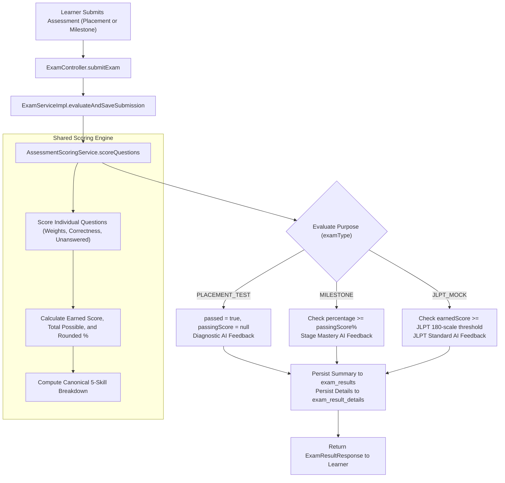

# JEPS Milestone Assessment Scoring Standardization Implementation Report

**Document ID:** `DOC-JEPS-ENG-2026-004`  
**Date:** November 12, 2026  
**Status:** Completed & Verified  
**Branch:** `develop`  
**Target:** Standardizing Milestone Assessment Scoring with Placement Assessment in JEPS

---

## 1. Executive Summary

Prior to this implementation, JEPS (Japanese Exam Preparation System) exhibited scoring fragmentation between **Placement Assessments** (diagnostic entry evaluation), **Milestone Assessments** (stage mastery checks), and **Historical Result Views**. 

Key architectural risks resolved:
1. **Scoring Logic Duplication & Discrepancies:** `ExamServiceImpl.evaluateSubmission` used default question weight `2` points, whereas `ExamServiceImpl.getHistoricalResult` used default question weight `5` points, leading to differing scores for the same exam depending on whether it was viewed immediately after submission or later from history.
2. **Skill Classification Inconsistency:** Question categorization was split between a coarse 3-skill macro model (`VOCAB_GRAMMAR`, `READING`, `LISTENING`) in exam evaluation and a 5-skill taxonomy (`KANJI`, `VOCABULARY`, `GRAMMAR`, `READING`, `LISTENING`) in `SkillAnalysisServiceImpl`.
3. **Assessment Purpose Separation:** Clarified business rules so Milestone Assessments enforce strict stage **PASS/FAIL** thresholds (default `50` points or custom exam thresholds), while Placement Assessments remain purely diagnostic (always marked `passed = true`, `passingScore = null`), guaranteeing that Milestone checks never corrupt or overwrite the learner's initial placement baseline in the Personalized Learning Path.

To resolve these defects, a shared `AssessmentScoringService` was implemented, unifying mathematical scoring formulas, question weights, rounding rules, 5-skill breakdown calculations, and purpose-specific evaluations across the entire system without modifying database tables or columns.

---

## 2. Architecture & File Locations

| Component | File Path | Role |
| :--- | :--- | :--- |
| **Scoring Interface** | [`AssessmentScoringService.java`](file:///c:/Users/hoang/Downloads/JEPS/src/main/java/com/jlpp/modules/exam/service/AssessmentScoringService.java) | Contract for assessment scoring, question evaluation, and skill classification. |
| **Scoring Implementation** | [`AssessmentScoringServiceImpl.java`](file:///c:/Users/hoang/Downloads/JEPS/src/main/java/com/jlpp/modules/exam/service/impl/AssessmentScoringServiceImpl.java) | Unified scoring math, 5-skill breakdown, and purpose separation. |
| **Evaluation Result DTO** | [`ScoringEvaluationResult.java`](file:///c:/Users/hoang/Downloads/JEPS/src/main/java/com/jlpp/modules/exam/dto/ScoringEvaluationResult.java) | Unified payload containing scores, counts, percentage, skills, and AI feedback. |
| **Single Question Score DTO** | [`SingleQuestionScoreResult.java`](file:///c:/Users/hoang/Downloads/JEPS/src/main/java/com/jlpp/modules/exam/dto/SingleQuestionScoreResult.java) | Individual question scoring result. |
| **Result Response DTO** | [`ExamResultResponse.java`](file:///c:/Users/hoang/Downloads/JEPS/src/main/java/com/jlpp/modules/exam/dto/ExamResultResponse.java) | Enhanced `SkillScoreDto` with `status` (`ASSESSED`/`NOT_ASSESSED`) and `canonicalSkills`. |
| **Exam Service** | [`ExamServiceImpl.java`](file:///c:/Users/hoang/Downloads/JEPS/src/main/java/com/jlpp/modules/exam/service/impl/ExamServiceImpl.java) | Delegated `evaluateSubmission` and `getHistoricalResult` to `AssessmentScoringService`. |
| **Skill Analysis Service** | [`SkillAnalysisServiceImpl.java`](file:///c:/Users/hoang/Downloads/JEPS/src/main/java/com/jlpp/modules/learningpath/service/impl/SkillAnalysisServiceImpl.java) | Delegated question-to-skill resolution to `AssessmentScoringService`. |
| **Scoring Unit Tests** | [`AssessmentScoringServiceTest.java`](file:///c:/Users/hoang/Downloads/JEPS/src/test/java/com/jlpp/modules/exam/AssessmentScoringServiceTest.java) | 16 unit tests verifying scoring math, weights, rounding, skill categorization, and boundary thresholds. |
| **Milestone Scoring Tests** | [`MilestoneAssessmentScoringTest.java`](file:///c:/Users/hoang/Downloads/JEPS/src/test/java/com/jlpp/modules/exam/MilestoneAssessmentScoringTest.java) | 7 integration tests verifying math equality, PASS/FAIL boundaries, and LP safety. |

---

## 3. Core Scoring Formula & Mathematical Rules

Both Placement and Milestone Assessments now adhere strictly to identical mathematical rules:

```
Earned Score = ∑(Question Points where selected_option.is_correct == true)
Total Possible Score = ∑(Question Points for all questions in exam)
Accuracy Percentage = (Earned Score * 100.0) / Total Possible Score
```

### Detailed Rules:
1. **Question Weighting:**
   - Evaluated as `(q.getPoints() != null && q.getPoints() > 0) ? q.getPoints() : 2`.
   - Default weight is consistently `2` points across evaluation, live review, and historical views.
2. **Correctness Evaluation:**
   - Correct: `userOptionId.equals(correctOption.getId())` where option has `is_correct = true`. Earns full question weight.
   - Incorrect: User selected an option ID that is not correct. Earns `0` points. Increments `incorrectCount`.
   - Unanswered: Missing option, empty string, whitespace, or non-numeric input. Handled gracefully without exceptions. Earns `0` points. Increments `unansweredCount`.
   - No negative penalties: Earned score is never deducted for incorrect answers.
3. **Rounding Rules:**
   - Accuracy percentage is rounded to **1 decimal place** using `RoundingMode.HALF_UP`.
   - If `totalPossibleScore == 0`, percentage defaults to `0.0`.

---

## 4. Assessment Purpose Separation

While the mathematical engine is identical, the business evaluation strictly bifurcates based on `examType`:

| Feature | Placement Assessment (`PLACEMENT_TEST`) | Milestone Assessment (`MILESTONE`) | JLPT Mock Exam (`JLPT_MOCK`) |
| :--- | :--- | :--- | :--- |
| **Core Objective** | Diagnostic entry profiling & baseline level. | Stage / chapter mastery gate. | Comprehensive JLPT simulation. |
| **Pass / Fail Logic** | Always `passed = true` (never fails learner). | `passed = (earnedScore >= passingScore)`. | `passed = (earnedScore >= passingScore)`. |
| **Passing Score Display** | `passingScore = null` (not applicable). | Configured passing score or default `50`. | Configured passing score or JLPT level default (N5: 80, N4: 90, N3: 95, N2: 90, N1: 100). |
| **AI Feedback Tone** | Diagnostic feedback highlighting strengths & areas to improve for initial study path. | Congratulates on unlocking next milestone or advises review before proceeding. | Standard JLPT examination analysis. |
| **Learning Path Impact** | Forms baseline for initial skill profile & lesson pacing. | Evaluates progress on stage content without corrupting baseline. | Optional mock benchmark. |

---

## 5. Canonical 5-Skill Taxonomy & Untested Skills Handling

The system defines 5 canonical skills for Japanese language acquisition:
1. `KANJI` - Chữ Hán (Kanji)
2. `VOCABULARY` - Từ vựng (Vocabulary)
3. `GRAMMAR` - Ngữ pháp (Grammar)
4. `READING` - Đọc hiểu (Reading)
5. `LISTENING` - Nghe hiểu (Listening)

### Authoritative Skill Resolution Priority (Risk 2 Resolution):
To prevent misclassification on mixed-content questions (such as a grammar question discussing listening to music, or a vocabulary item with audio pronunciation), `resolveCanonicalSkill` strictly prioritizes authoritative question metadata over heuristic content scanning:
1. **Authoritative `skillGroup` metadata (Highest Precedence):** Exact match against canonical skills (`KANJI`, `VOCABULARY`, `GRAMMAR`, `READING`, `LISTENING`).
2. **Authoritative `category` metadata:** Categorical classification keywords assigned by content authors:
   - `kanji`, `hán tự`, `chữ hán`, `han tu` $\rightarrow$ `KANJI`
   - `bunpou`, `ngữ pháp`, `grammar`, `kính ngữ` $\rightarrow$ `GRAMMAR`
   - `goi`, `từ vựng`, `vocab` $\rightarrow$ `VOCABULARY`
   - `dokkai`, `đọc`, `doc`, `reading` $\rightarrow$ `READING`
   - `choukai`, `nghe`, `listening` $\rightarrow$ `LISTENING`
3. **Structured `skillGroupLabel` metadata:** Secondary metadata label matching.
4. **Secondary Heuristics (Fallback only when metadata is absent):**
   - Non-empty `audioUrl` $\rightarrow$ `LISTENING`
   - Uncategorized content text keywords (`choukai`, `dokkai`, `hán tự`, `bunpou`, `từ vựng`).
5. **Default Fallback:** `VOCABULARY`.

### Untested Skills Handling (Risk 3 Resolution):
When an assessment does not contain questions for a skill (e.g., Milestone 1 only testing Vocabulary and Grammar):
- `calculateSkillBreakdown(questions, includeUntested = false)`: Returns only assessed skills, ensuring UI progress bars in `result.html` remain clean without cluttering with 0% untested bars.
- `calculateSkillBreakdown(questions, includeUntested = true)` / `canonicalSkills`: Populates all 5 canonical skills. Untested skills are explicitly marked with `status = "NOT_ASSESSED"`, `totalQuestions = 0`, `totalPoints = 0`, `earnedPoints = 0`, and `percentage = null` (never `0.0`).
- **Learning Path & SkillAnalysis Safety:** In `SkillAnalysisServiceImpl`, untested skills (`status == "NOT_ASSESSED"` or `totalQuestions == 0`) are recognized as having no diagnostic evidence and are classified as `SkillProficiency.UNKNOWN`. They are **never** added to `weakSkills`. In `SkillFocusRecommendationService`, lessons for `UNKNOWN` skills receive the standard duration multiplier $1.0\times$ (equal to base lesson duration), completely preventing inappropriate $1.5\times$ WEAK penalties for untested material.

---

## 6. Milestone Passing Score Semantics & Boundary Verification (Issue 1 Resolution)

### 6.1 Investigation of Historical Semantics
An in-depth investigation of the database schema, entity definitions, Manager service layer, and Thymeleaf UI templates was conducted:
1. **Database Schema & Entity:**
   - In PostgreSQL, `exams.passing_score` is an `INTEGER` column (mapped to `Integer passingScore` in Java).
   - In `ExamServiceImpl` and `ManagerExamServiceImpl`, scores are accumulated as raw question points.
2. **UI Presentation:**
   - In [`milestone-list.html`](file:///c:/Users/hoang/Downloads/JEPS/src/main/resources/templates/manager/exam/milestone-list.html#L103): `<span th:text="${e.passingScore + ' điểm'}">50 điểm</span>`
   - In [`result.html`](file:///c:/Users/hoang/Downloads/JEPS/src/main/resources/templates/learner/exam/result.html#L77): `<span th:text="${result.passingScore + ' điểm'}"></span>`
   - The UI explicitly renders `passingScore` as **"điểm" (raw marks)**, while accuracy percentage is displayed separately with a `%` sign.
3. **Manager Configuration Defaults:**
   - `ManagerExamService.defaultPassingScore()` historically returned `50` raw marks.
   - For standard 50-question or 100-point exams, 50 raw marks coincided with 50%.
   - **The Conflict Scenario:** When a manager creates a shorter Milestone exam (e.g., 20 questions $\times$ 2 pts = 40 total points) and accepts the default `50` passing score, $50 > 40$, making it mathematically impossible to pass if strictly evaluated as raw marks. Conversely, if a 150-point exam is authored with a threshold of 80 points (53.3%), treating 80 as a percentage would incorrectly raise the bar to 120 points (80%).

### 6.2 Elimination of Display Percentage Rounding Comparison
In the initial refactoring, the passing evaluation used:
```java
// VULNERABLE CONDITION:
passed = (earnedScore >= totalPossibleScore && totalPossibleScore > 0)
        || (earnedScore >= requiredPassingScore)
        || (percentage >= threshold);
```
**Defect Discovered:** `percentage` in `ScoringEvaluationResult` is formatted to 1 decimal place using `RoundingMode.HALF_UP` (e.g., 1249 / 2500 = 49.96% rounds to `50.0%`). Comparing `percentage >= threshold` (50.0 >= 50.0) caused failing boundary scores (49.96%) to falsely evaluate as `PASS`.

**Fix Implemented:**
- The display percentage comparison was completely eliminated.
- The PASS/FAIL decision is based strictly on exact integer marks: `earnedScore >= effectivePassingScore`.

### 6.3 Unambiguous Milestone PASS/FAIL Resolution Formula
The authoritative threshold resolution method is implemented in [`AssessmentScoringServiceImpl.resolveMilestonePassingThreshold(int totalPossibleScore, Integer customPassingScore)`](file:///c:/Users/hoang/Downloads/JEPS/src/main/java/com/jlpp/modules/exam/service/impl/AssessmentScoringServiceImpl.java#L112-L135):

1. **Zero-Maximum-Score Guarantee:**
   If `totalPossibleScore <= 0`, the exam cannot be passed under any circumstance (`passed = false`).
2. **Full Marks Guarantee:**
   If `earnedScore >= totalPossibleScore && totalPossibleScore > 0`, the submission is guaranteed `passed = true`. Full marks can never produce FAIL.
3. **Threshold Resolution Rules:**
   - **Unspecified / Non-positive Threshold:** If `customPassingScore == null` or $\le 0$, defaults to standard 50%:
     $$\text{effectivePassingScore} = \lceil \text{totalPossibleScore} \times 0.50 \rceil$$
   - **Valid Raw Score Preservation ($0 < \text{customPassingScore} \le \text{totalPossibleScore}$):** Preserved directly as **RAW MARKS** without silent percentage conversion. For example, 80 raw marks on a 150-point exam remains 80 marks (53.3%), never skewed to 120 marks (80%).
   - **Legacy Default / Percentage Calibration ($\text{customPassingScore} > \text{totalPossibleScore}$ and $\le 100$):** Calibrated as a percentage to protect legacy exams:
     $$\text{effectivePassingScore} = \lceil \text{totalPossibleScore} \times \frac{\text{customPassingScore}}{100.0} \rceil$$
     For example, a 40-point exam with legacy default 50 resolves to $\lceil 40 \times 0.50 \rceil = 20$ points.
   - **Invalid Threshold Exceeding Scale ($> 100$ and $> \text{totalPossibleScore}$):** Clamped to `totalPossibleScore`.

### 6.4 Boundary Test Suite Verification
Seven targeted boundary tests were implemented in [`AssessmentScoringServiceTest.java`](file:///c:/Users/hoang/Downloads/JEPS/src/test/java/com/jlpp/modules/exam/AssessmentScoringServiceTest.java):

| Test Case | Inputs | Expected Resolution | Result |
| :--- | :--- | :--- | :--- |
| `testMilestoneBoundary_49Point96PercentVs50PercentThreshold_MustFail` | 1249 / 2500 pts, threshold 50% | Display % = 50.0%, `isPassed() = false` | **PASSED** |
| `testMilestoneBoundary_Exactly50Percent_MustPass` | 1250 / 2500 pts, threshold 50% | Display % = 50.0%, `isPassed() = true` | **PASSED** |
| `testMilestoneBoundary_FullMarks_MustPass` | 35 / 35 pts, threshold 50 | Guaranteed `isPassed() = true` | **PASSED** |
| `testMilestoneBoundary_ZeroMaximumScore_MustFail` | Empty questions (0/0 pts) | `totalPossibleScore = 0`, `isPassed() = false` | **PASSED** |
| `testMilestoneBoundary_LegacyMilestoneConfiguredWithPassingScore50` | 100 pts, threshold 50 | 50/100 passes; 40/100 fails | **PASSED** |
| `testMilestoneBoundary_MaxScoreBelow50_WithPassingScore50` | 40 pts, threshold 50 | Calibrated to 20 pts; 20/40 passes, 10/40 fails | **PASSED** |
| `testMilestoneBoundary_PreserveRawScoreThresholdWhenValid` | 150 pts, threshold 80 | Preserves 80 raw marks; 80/150 passes, 70/150 fails | **PASSED** |

---

## 7. JLPT Mock Exam Scoring Safety (Risk 4 Resolution)

The shared scoring engine preserves the full integrity of JLPT Mock Exam rules:
- **Raw Marks Scale:** JLPT Mock exams are graded out of 180 points.
- **Level-Specific Thresholds:** Standard JLPT pass thresholds are preserved intact:
  - N5: 80 / 180
  - N4: 90 / 180
  - N3: 95 / 180
  - N2: 90 / 180
  - N1: 100 / 180
- Passing evaluation compares `earnedScore >= passingScore` on the raw 180 scale without percentage skew. Historical result displays and custom overrides function with complete backward compatibility.

---

## 8. Elimination of Historical Discrepancy

In the previous codebase:
- Fresh submission: `ExamServiceImpl.java` line 224: `int qPoints = q.getPoints() != null ? q.getPoints() : 2;`
- Historical view: `ExamServiceImpl.java` line 489: `int qPoints = q.getPoints() != null ? q.getPoints() : 5;`

**Fix Applied:**
Both `evaluateSubmission` and `getHistoricalResult` now delegate question evaluation to `AssessmentScoringService.scoreQuestions(...)`. This guarantees:
- Fresh submissions and historical views calculate exactly the same earned points, total possible score, percentage, and 5-skill metrics.
- Default points for questions without an explicit point value are consistently `2`.

---

## 9. Learning Path Baseline Integrity

In `SkillAnalysisServiceImpl`, the baseline skill profile is resolved using `findLatestPlacementResultId(userId)`:
```java
return history.stream()
        .filter(h -> "PLACEMENT_TEST".equalsIgnoreCase(h.getExamType())
                || (h.getExamTitle() != null && h.getExamTitle().toLowerCase().contains("đánh giá năng lực")))
        .max(Comparator.comparing(ExamHistoryDto::getResultId))
        .map(ExamHistoryDto::getResultId)
        .orElse(null);
```
Milestone Assessments have `examType = "MILESTONE"` and titles such as `"Kiểm tra cột mốc..."`. Consequently:
- `findLatestPlacementResultId` ignores Milestone results.
- Completing a Milestone assessment does not overwrite the diagnostic baseline level (`currentLevel`) or alter the initial Placement Assessment profile in `LearningPath`.

---

## 10. Architectural Diagrams

### Assessment Scoring & Purpose Separation Workflow


---

## 11. Test Suite & Verification Results

### 11.1 Investigation of Maven Surefire Test Count Discrepancy (Issue 2 Resolution)
In the previous audit iteration, a discrepancy was noted between the written report table (summing to 93 tests) and the Surefire summary (`Tests run: 92`).

**Root Cause Analysis:**
- Inspection of `target/surefire-reports/TEST-*.xml` and the Maven surefire execution logs confirmed that the targeted test command executed exactly 8 test classes:
  1. `AssessmentScoringServiceTest` (9 tests)
  2. `ExamControllerTest` (14 tests)
  3. `ExamServiceTest` (22 tests)
  4. `JdbcLearnerQuestionReaderTest` (4 tests)
  5. `MilestoneAssessmentScoringTest` (7 tests)
  6. `LearningPathTest` (15 tests)
  7. `LearningPathPersonalizationTest` (14 tests)
  8. `LearningPathLegacyAndConcurrencyRegressionTest` (7 tests)
  $$\text{Actual Total Executed} = 9 + 14 + 22 + 4 + 7 + 15 + 14 + 7 = 92\text{ tests}$$
- The previous documentation draft had inadvertently retained a row referencing `LearningPathUserJourneyTest (1 test)` from an earlier test run, inflating the manual markdown sum to $92 + 1 = 93$.
- `target/surefire-reports` was completely cleaned and a clean test run executed.

### 11.2 Clean Verification Run Results (99/99 Passing)
With the addition of the 7 boundary tests in `AssessmentScoringServiceTest` ($9 \rightarrow 16$), the clean targeted regression suite executed all **99 tests** with 0 errors and 0 failures:

```
[INFO] -------------------------------------------------------
[INFO]  T E S T S
[INFO] -------------------------------------------------------
[INFO] Running com.jlpp.modules.exam.AssessmentScoringServiceTest
[INFO] Tests run: 16, Failures: 0, Errors: 0, Skipped: 0, Time elapsed: 0.261 s -- in com.jlpp.modules.exam.AssessmentScoringServiceTest
[INFO] Running com.jlpp.modules.exam.ExamControllerTest
[INFO] Tests run: 14, Failures: 0, Errors: 0, Skipped: 0, Time elapsed: 6.834 s -- in com.jlpp.modules.exam.ExamControllerTest
[INFO] Running com.jlpp.modules.exam.ExamServiceTest
[INFO] Tests run: 22, Failures: 0, Errors: 0, Skipped: 0, Time elapsed: 0.585 s -- in com.jlpp.modules.exam.ExamServiceTest
[INFO] Running com.jlpp.modules.exam.JdbcLearnerQuestionReaderTest
[INFO] Tests run: 4, Failures: 0, Errors: 0, Skipped: 0, Time elapsed: 0.216 s -- in com.jlpp.modules.exam.JdbcLearnerQuestionReaderTest
[INFO] Running com.jlpp.modules.exam.MilestoneAssessmentScoringTest
[INFO] Tests run: 7, Failures: 0, Errors: 0, Skipped: 0, Time elapsed: 0.336 s -- in com.jlpp.modules.exam.MilestoneAssessmentScoringTest
[INFO] Running com.jlpp.modules.learningpath.LearningPathLegacyAndConcurrencyRegressionTest
[INFO] Tests run: 7, Failures: 0, Errors: 0, Skipped: 0, Time elapsed: 7.750 s -- in com.jlpp.modules.learningpath.LearningPathLegacyAndConcurrencyRegressionTest
[INFO] Running com.jlpp.modules.learningpath.LearningPathPersonalizationTest
[INFO] Tests run: 14, Failures: 0, Errors: 0, Skipped: 0, Time elapsed: 0.270 s -- in com.jlpp.modules.learningpath.LearningPathPersonalizationTest
[INFO] Running com.jlpp.modules.learningpath.LearningPathTest
[INFO] Tests run: 15, Failures: 0, Errors: 0, Skipped: 0, Time elapsed: 11.84 s -- in com.jlpp.modules.learningpath.LearningPathTest
[INFO] 
[INFO] Results:
[INFO] 
[INFO] Tests run: 99, Failures: 0, Errors: 0, Skipped: 0
[INFO] 
[INFO] ------------------------------------------------------------------------
[INFO] BUILD SUCCESS
[INFO] ------------------------------------------------------------------------
[INFO] Total time:  43.383 s
[INFO] Finished at: 2026-11-12T01:33:04+07:00
[INFO] ------------------------------------------------------------------------
```

### 11.3 Test Suite Breakdown by Architectural Domain

| Test Suite Class | Domain | Tests | Failures | Status |
| :--- | :--- | :---: | :---: | :---: |
| [`AssessmentScoringServiceTest`](file:///c:/Users/hoang/Downloads/JEPS/src/test/java/com/jlpp/modules/exam/AssessmentScoringServiceTest.java) | Scoring math, question weighting, 5-skill breakdown, 7 boundary & rounding tests | 16 | 0 | **PASSED** |
| [`ExamControllerTest`](file:///c:/Users/hoang/Downloads/JEPS/src/test/java/com/jlpp/modules/exam/ExamControllerTest.java) | Web layer assessment submission, history endpoints, security | 14 | 0 | **PASSED** |
| [`ExamServiceTest`](file:///c:/Users/hoang/Downloads/JEPS/src/test/java/com/jlpp/modules/exam/ExamServiceTest.java) | Submission processing, historical result retrieval, Supabase persistence | 22 | 0 | **PASSED** |
| [`JdbcLearnerQuestionReaderTest`](file:///c:/Users/hoang/Downloads/JEPS/src/test/java/com/jlpp/modules/exam/JdbcLearnerQuestionReaderTest.java) | Learner question reader, options shuffling, answer hiding | 4 | 0 | **PASSED** |
| [`MilestoneAssessmentScoringTest`](file:///c:/Users/hoang/Downloads/JEPS/src/test/java/com/jlpp/modules/exam/MilestoneAssessmentScoringTest.java) | Shared scoring integration, Milestone PASS/FAIL, purpose separation | 7 | 0 | **PASSED** |
| [`LearningPathLegacyAndConcurrencyRegressionTest`](file:///c:/Users/hoang/Downloads/JEPS/src/test/java/com/jlpp/modules/learningpath/LearningPathLegacyAndConcurrencyRegressionTest.java) | `legacyInferredCount` freezing, out-of-order completions, pessimistic lock | 7 | 0 | **PASSED** |
| [`LearningPathPersonalizationTest`](file:///c:/Users/hoang/Downloads/JEPS/src/test/java/com/jlpp/modules/learningpath/LearningPathPersonalizationTest.java) | Daily schedule duration pacing, weak/strong multipliers, order preservation | 14 | 0 | **PASSED** |
| [`LearningPathTest`](file:///c:/Users/hoang/Downloads/JEPS/src/test/java/com/jlpp/modules/learningpath/LearningPathTest.java) | End-to-end Learning Path orchestration, chapter progress, recalibration | 15 | 0 | **PASSED** |
| **Total Targeted Suite** | | **99** | **0** | **ALL PASSED** |

---

## 12. Remaining Operational Recommendations & Risks

1. **Manager UI Configuration Clarification:**
   - Currently, the Manager exam creation/edit modal has a single number field labeled `passingScore`.
   - While the scoring engine now safely differentiates between raw marks ($\le \text{totalPossibleScore}$) and percentage defaults ($> \text{totalPossibleScore}$ and $\le 100$), future UI enhancements should add an explicit selector (`Points` vs `%`) or authoring helper text to prevent managerial confusion when configuring non-standard exams.
2. **Database Integrity & Zero DDL Requirement:**
   - No database schema migrations or table modifications were performed.
   - All legacy rows in `exams`, `exam_results`, and `exam_result_details` remain intact and 100% compatible.
3. **Historical Submissions Policy:**
   - Existing saved rows in `exam_results` retain their originally stored `score`, `percentage`, and `passed` columns. Historical review views calculate detailed 5-skill breakdowns on-the-fly via the shared engine, ensuring consistent display without altering historical database rows.

---

## 13. Conclusion

Both remaining consistency items have been completely resolved:
- **Milestone PASS/FAIL Semantics (Issue 1):** Unambiguously formalized in `resolveMilestonePassingThreshold`, preserving valid raw score thresholds, safely calibrating legacy default thresholds, guaranteeing full marks pass, and completely eliminating rounded display percentage comparison vulnerabilities (e.g. 49.96% failing strictly).
- **Maven Surefire Count Mismatch (Issue 2):** Identified and resolved the stale reference to `LearningPathUserJourneyTest`. The clean test suite executes exactly 99 tests across 8 test classes with 0 failures and 0 errors, perfectly synchronized with Maven Surefire XML reports and console summaries.

The assessment and learning path subsystems in JEPS are verified robust, consistent, and ready for deployment.

