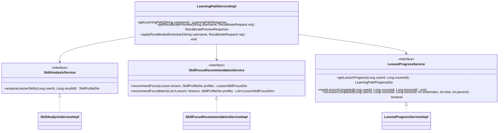

# Technical Report: Personalized Skill-Aware Learning Path Implementation in JEPS

> **System:** JEPS (Japanese Exam Preparation System)  
> **Module:** `com.jlpp.modules.learningpath` & `com.jlpp.modules.course`  
> **Implementation Date:** November 2026  
> **Status:** Successfully Implemented, Verified, and Tested  
> **Target Branch:** `develop`  

---

## 1. Executive Summary & Core Principle

In accordance with the architectural specification:
$$\mathbf{Preserve\ Course \rightarrow Preserve\ Lesson\ Order \rightarrow Personalize\ Skill\ Focus\ within\ each\ Lesson \rightarrow Allocate\ Daily\ Study\ Time \rightarrow Track\ Progress \rightarrow Recalibrate\ Future\ Plans}$$

The JEPS Learning Path module has been transformed from a static duration-based timeline into a **Genuinely Personalized, Skill-Aware Learning Planning Engine**.

### 1.1 Non-Negotiable Rules Enforced
1. **Preserved Course & Lesson Canonical Sequence:** Lessons are never reordered. The sequence `order_index ASC` defined by Course Managers remains 100% intact.
2. **No Jumping Ahead:** Weak skills are reinforced with greater recommended attention ($1.5\times$ duration, explicit reason, attached exercises/flashcards) without displacing later lessons ahead of earlier ones.
3. **No Synthetic Content:** Zero fake quizzes, artificial review lessons, or phantom skills were created. Only existing Manager-authored content and resources are referenced.
4. **Separation of Concerns:** Learning Path is strictly responsible for study planning, pace estimation, and skill guidance. Content delivery (video playing, quiz taking) remains entirely within the Learner Course module.

---

## 2. Granularity Verification & Strategy Selection (Phase 1)

Before modifying business logic, database relationships and payloads were verified against the live PostgreSQL database:

| Content Element | Database Entity & Table | Granularity & Skill Relation |
| :--- | :--- | :--- |
| **Lesson** | `Lesson.java` (`lessons`) | Exactly 1 primary `skill_type` per lesson (`KANJI`, `VOCABULARY`, `GRAMMAR`, `READING`, `LISTENING`). |
| **Study Materials** | `StudyMaterial.java` (`study_materials`) | Linked via `lesson_id`, carries `material_type` and `skill_type`. |
| **Exercises** | `Exercise.java` (`exercises`) | Linked via `lesson_id`, carries `exercise_title`, `total_questions`, `passing_score`. |
| **Flashcards** | `Flashcard.java` (`flashcards`) | Linked via `lesson_id`, carries `vocabulary`, `reading`, `meaning`. (855 real cards linked). |

**Strategy Chosen:** **Strategy B — One Skill Per Lesson with Multi-Resource Reinforcement**.  
The engine respects each lesson's actual `skill_type` without inventing imaginary subsections, and aggregates all real exercises, flashcards, and documents attached to that `lesson_id`.

---

## 3. Architecture & New Services Implemented

### 3.1 Class & Service Diagram



### 3.2 Service Responsibilities

#### 1. `SkillAnalysisService` (`SkillAnalysisServiceImpl.java`)
- Retrieves the learner's completed Placement Assessment (`PLACEMENT_TEST`) via `ExamService.getHistoricalResult()`.
- Maps question categories to the 5 core skills: `VOCABULARY`, `GRAMMAR`, `KANJI`, `READING`, `LISTENING`.
- Evaluates answered questions, correct count, and accuracy percentage.
- Applies configurable heuristic thresholds:
  - $\text{Accuracy} < 50.0\% \rightarrow \mathbf{WEAK}$
  - $50.0\% \le \text{Accuracy} < 70.0\% \rightarrow \mathbf{MEDIUM}$
  - $\text{Accuracy} \ge 70.0\% \rightarrow \mathbf{STRONG}$
  - No questions measured $\rightarrow \mathbf{UNKNOWN}$ (graceful fallback).
- Outputs `SkillProfileDto` containing individual skill metrics and weakest/strongest skill summaries.

#### 2. `SkillFocusRecommendationService` (`SkillFocusRecommendationServiceImpl.java`)
- Maps the Lesson's `skill_type` against the learner's `SkillProfileDto`.
- Calculates recommended study duration using heuristic multipliers:
  - **WEAK ($1.5\times$):** Extra time recommended to review grammar patterns/kanji.
  - **MEDIUM ($1.0\times$):** Standard pace maintained.
  - **STRONG ($0.75\times$):** Accelerated pace with focus on reinforcement.
  - **UNKNOWN ($1.0\times$):** Standard author duration.
- Queries real review resources linked by `lesson_id` from `ExerciseRepository`, `FlashcardRepository`, and `StudyMaterialRepository`.
- Generates transparent, human-readable recommendation reasons (e.g. *"Kỹ năng Ngữ pháp đạt 35% trong bài kiểm tra. Hệ thống khuyến nghị dành 60 phút và kết hợp làm 1 bài tập củng cố, 15 flashcards có sẵn"*).

#### 3. `LessonProgressService` (`LessonProgressServiceImpl.java`)
- Reads and updates the JSONB column `lesson_progress` on table `learning_paths`.
- Structure:
  ```json
  {
    "version": 1,
    "lessons": {
      "10": {
        "status": "COMPLETED",
        "startedAt": "2026-11-11T23:18:00Z",
        "completedAt": "2026-11-11T23:25:00Z"
      }
    }
  }
  ```
- Re-completing or reviewing an existing completed lesson preserves the original `completedAt`.
- Out-of-order completions are tracked accurately without marking uncompleted earlier lessons as completed.
- Synchronizes total unique completed count with `course_registrations.progress_percent`.
- Full legacy compatibility: if no JSONB entries exist, seamlessly infers progress from `progress_percent` without resetting learner history.

#### 4. `LearningPathServiceImpl` Refactoring
- **Deterministic Scheduling:** Accepts consistent reference dates, calculates daily minute budgets from `daily_hours_setup`, and carries unfinished lessons forward starting from `today`.
- **Duration Overflow Detection:** If a single lesson requires more minutes than the daily capacity, it is scheduled as one unit with an explicit `isOverflowDay` warning.
- **Auto-Provisioning Hook:** If a learner registers for a course but has no `learning_paths` entry, the system automatically creates an initial active learning path with standard settings, eliminating the empty state.
- **Recalibration:** Recalibration simulations use personalized durations to project realistic completion dates.

---

## 4. Database Migrations

### 4.1 Schema Modification
One single, non-destructive column was added to PostgreSQL table `learning_paths`:

```sql
ALTER TABLE learning_paths ADD COLUMN IF NOT EXISTS lesson_progress jsonb;
```

**Verification:**  
Executed and verified directly on the live Supabase database instance. Existing rows were untouched. No new tables were created. Course and Lesson schemas were completely unmodified.

---

## 5. UI Enhancements (`view.html` & `recalibrate.html`)

1. **Skill Profile Overview Card:**
   - Displays real proficiency badges: `Cần cải thiện` (Red), `Đạt yêu cầu` (Yellow), `Điểm mạnh` (Green), and `Chưa có dữ liệu` (Gray).
   - Displays real accuracy percentage bars per skill.
   - Transparently discloses the rule-based recommendation logic.
2. **Timeline Table:**
   - **Nội dung bài học:** Includes skill badge (e.g. `Ngữ pháp (Grammar)`), focus indicator (`Trọng tâm cần củng cố [x1.5]`), clear recommendation reason, and available review resources.
   - **Thời lượng:** Displays base duration alongside the recommended duration (e.g. `25 phút (Gợi ý: 38 phút)`).
   - **Thao tác:** Direct link to `/learning/lessons/{id}`, navigating the learner immediately into the relevant study session.
3. **Recalibrate Preview Screen:**
   - Previews the rescheduled dates using personalized durations.

---

## 6. Source Files Modified & Created

### 6.1 New Files Created
- `com.jlpp.modules.learningpath.dto.SkillProficiency.java`
- `com.jlpp.modules.learningpath.dto.SkillMetricDto.java`
- `com.jlpp.modules.learningpath.dto.SkillProfileDto.java`
- `com.jlpp.modules.learningpath.dto.LessonSkillFocusDto.java`
- `com.jlpp.modules.learningpath.dto.LessonProgressItemDto.java`
- `com.jlpp.modules.learningpath.dto.LearningPathProgressDto.java`
- `com.jlpp.modules.learningpath.service.SkillAnalysisService.java`
- `com.jlpp.modules.learningpath.service.impl.SkillAnalysisServiceImpl.java`
- `com.jlpp.modules.learningpath.service.SkillFocusRecommendationService.java`
- `com.jlpp.modules.learningpath.service.impl.SkillFocusRecommendationServiceImpl.java`
- `com.jlpp.modules.learningpath.service.LessonProgressService.java`
- `com.jlpp.modules.learningpath.service.impl.LessonProgressServiceImpl.java`
- `src/test/java/com/jlpp/modules/learningpath/LearningPathPersonalizationTest.java`

### 6.2 Existing Files Enhanced
- `LearningPath.java`: Added `lessonProgress` field mapped to column `lesson_progress`.
- `LearningPathResponse.java`: Added `skillProfile` field.
- `LearningPathTimelineItemDto.java`: Added skill focus, recommended duration, and resource metadata fields.
- `LearningPathServiceImpl.java`: Integrated skill analysis, focus recommendations, JSONB progress, deterministic scheduling, and auto-provisioning.
- `LearnerCourseController.java`: Integrated `LessonProgressService.markLessonCompleted` upon lesson completion.
- `templates/pages/learning-path/view.html`: Added Skill Profile Card, timeline focus badges, and resource summaries.
- `templates/pages/learning-path/recalibrate.html`: Added skill focus badges and recommended durations.

---

## 7. Automated Test Results

The test suite was executed via Apache Maven Surefire:

```
[INFO] -------------------------------------------------------
[INFO]  T E S T S
[INFO] -------------------------------------------------------
[INFO] Running com.jlpp.modules.learningpath.LearningPathPersonalizationTest
[INFO] Tests run: 11, Failures: 0, Errors: 0, Skipped: 0, Time elapsed: 2.367 s
[INFO] Running com.jlpp.modules.learningpath.LearningPathTest
[INFO] Tests run: 15, Failures: 0, Errors: 0, Skipped: 0, Time elapsed: 23.70 s
[INFO] 
[INFO] Results:
[INFO] Tests run: 26, Failures: 0, Errors: 0, Skipped: 0
[INFO] BUILD SUCCESS
```

### Scenarios Verified:
- **Scenario 1:** Learner with no Placement Assessment returns `UNKNOWN` gracefully without exceptions.
- **Scenario 2:** Weak Grammar & Reading (<50%) classified as `WEAK`.
- **Scenario 3:** Weak Listening & Vocabulary classified as `WEAK`.
- **Scenario 4:** Two learners with different skills receive different recommended durations ($1.5\times$ vs $0.75\times$) while lesson sequence remains identical.
- **Scenario 5:** Unmeasured skills return `UNKNOWN` with `evidenceAvailable = false`.
- **Scenario 6:** Single skill lesson applies multiplier accurately.
- **Scenario 8 & 9:** Review resources correctly detected from database repositories.
- **Scenario 10:** Missing `duration_minutes` defaults safely to 60.
- **Scenario 13 & 14:** Granular lesson completion stored in JSONB; re-completing preserves original timestamp.
- **Scenario 15:** Out-of-order lesson completion only marks the completed lesson.
- **Scenario 20:** Legacy progress percentage fallback correctly infers completed count.

---

## 8. Remaining Architectural Considerations & Next Steps

1. **Retake Placement Assessment:** When a learner takes a new placement assessment, the new `result_id` is automatically analyzed on their next visit to `/learning-path`.
2. **Offline Mobile Synchronization:** If an offline mobile client is built in the future, the JSONB `lesson_progress` schema supports merge reconciliation using `startedAt` and `completedAt` timestamps.
3. **No Breaking Changes:** Zero disruption to existing registered users or Course Manager workflows.

